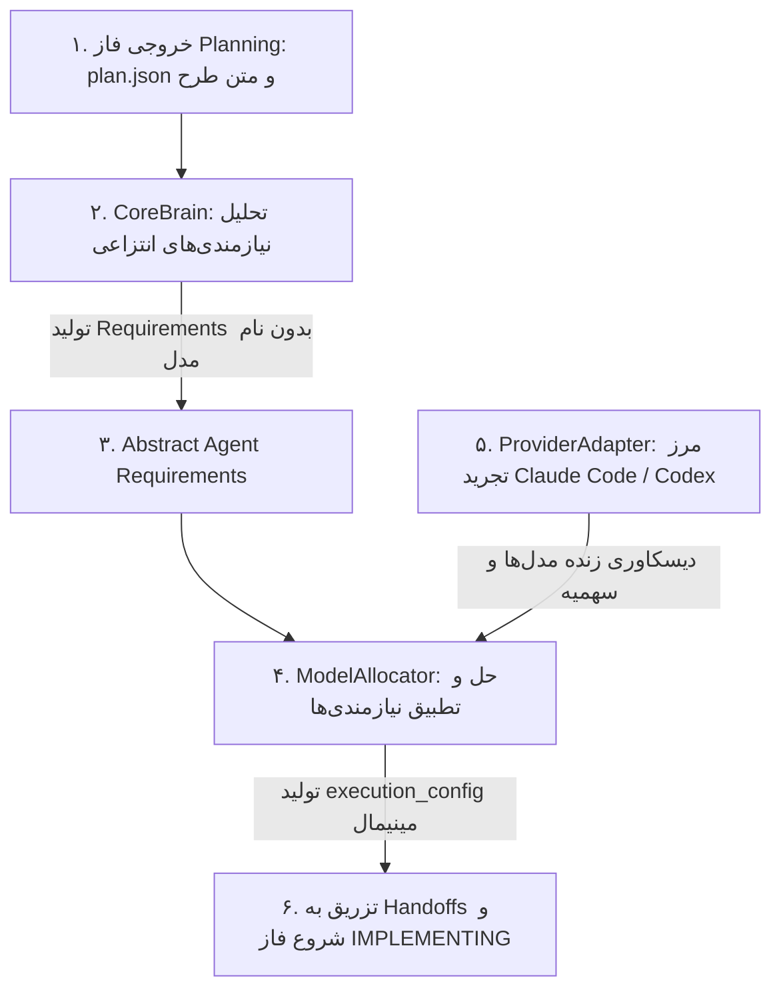

# Adaptive Model Allocation Governance Specification
## Two-Stage Dynamic Dispatch: CoreBrain Requirements Analysis & ModelAllocator Resolution

این سند مشخصات فنی «موتور تخصیص تطبیقی مدل‌ها (Adaptive Model Allocation Engine)» را تعریف می‌کند. این سازوکار بلافاصله پس از تکمیل فاز برنامه‌ریزی (`PLANNING`) و در خلال اعتبارسنجی طرح (`PLAN_VALIDATION`)، بر اساس تحلیل نیازمندی‌های عینی هر نقش و وضعیت پرووایدر فعال، پیکربندی اجرایی بهینه را تعیین می‌نماید.

---

## 🏛️ ۱. اصول راهبردی و تفکیک معماری (Architectural Separation of Concerns)

بر اساس اصول Clean Architecture و تفکیک مسئولیت‌ها (SoC)، فرآیند تخصیص مدل به دو مسئولیت مستقل و یک مرز تجرید تفکیک می‌شود:



1. **تفکیک CoreBrain از ModelAllocator**:
   - **`CoreBrain`**: تحلیلگر معنایی طرح است. تنها وظیفه آن تعیین نیازمندی‌های کیفی هر ایجنت (`capability`, `reasoning`, `risk`, `confidence`) است. CoreBrain **هرگز مدل مشخص یا نام ارائه‌دهنده‌ای را انتخاب نمی‌کند**.
   - **`ModelAllocator`**: موتور حل‌کننده (Resolver) است. نیازمندی‌های انتزاعی CoreBrain را گرفته و با استعلام از `ProviderAdapter` فعال، آن را به یک پیکربندی عینی قابل اجرا تبدیل می‌کند.
2. **پرهیز از رده‌های ثابت و صلب بر اساس نقش (Dynamic Requirements, Not Fixed Tiers)**:
   - سیستم رده‌های صلب که نقش‌ها را به مدل‌های خاص گره بزند (مثلاً این فرض که Coder همیشه گران‌تر از Tester یا Critic است) مردود است.
   - نیازمندی‌های هر ایجنت منحصراً از روی **طرح پیاده‌سازی تکمیل‌شده، سطح ریسک و نوع کار تخصیص‌یافته به آن ایجنت** استخراج می‌شود.
3. **عدم هاردکد نام مدل‌ها و استقلال پرووایدرها (ProviderAdapter Boundary)**:
   - هیچ نام مدلی در لاجیک مرکزی یا جداول استاتیک هسته هاردکد نمی‌شود.
   - دیسکاوری مدل‌ها، وضعیت سهمیه و ریت‌لیمیت تماماً در پشت اینترفیس `ProviderAdapter` ایزوله است.
   - ارائه‌دهندگان هدف در فاز اول (V1): **Claude Code** و **OpenAI Codex** (محیط Antigravity در فاز V1 تارگت مسیریابی پرووایدر نیست).
4. **عبور پیش‌فرض امن (Graceful Default Client Passthrough)**:
   - در صورتی که هیچ‌یک از پرووایدرهای پشتیبانی‌شده (Claude Code یا Codex) در محیط شناسایی نشوند، سیستم به صورت کاملاً امن و بدون خطا به رفتار پیش‌فرض فعلی Core بازمی‌گردد و هیچ تغییری در اجرای کلاینت ایجاد نمی‌کند.
5. **رژیم کانتکست و سقف ۵ کیلوبایت (Context Budget & Token Diet)**:
   - کاتالوگ مدل‌ها، متادیتای حجیم Brain یا لاگ‌های دیسکاوری هرگز به فایل‌های Handoff تزریق نمی‌شوند. Handoff صرفاً یک بلوک سبک و نهایی `execution_config` (کمتر از ۱۰۰ بایت) دریافت می‌کند.

---

## 🔄 ۲. نقطه ادغام در ماشین حالت تسک‌ها (State Machine Sub-Stage)

تخصیص مدل به عنوان یک ساب‌استیت اختصاصی در وضعیت ۵ ماشین حالت (`PLAN_VALIDATION`) و پیش از ورود به فاز ۶ (`IMPLEMENTING`) اجرا می‌گردد:

```text
[State 4: PLANNING]
   │
   ├─ تولید implementation_plan.md و plan.json توسط Senior Planner
   │
   ▼
[State 5: PLAN_VALIDATION]
   │
   ├── [Sub-Stage 5.1: Plan Human / Governance Validation]
   │     └── اعتبارسنجی سطح ریسک و تطبیق با سیاست تایید کاربر
   │
   ├── [Sub-Stage 5.2: Adaptive Model Allocation Hook]
   │     ├── ۱. فراخوانی CoreBrain.analyzePlan(...)
   │     │     └── در صورت خطا/تایم‌اوت ➔ اجرای DeterministicFallbackBrain
   │     │     └── ذخیره خروجی در .agents/tasks/<TASK_ID>/requirements.json
   │     ├── ۲. استعلام از ProviderAdapter فعال (Claude Code / Codex)
   │     ├── ۳. فراخوانی ModelAllocator.allocate(...)
   │     │     └── ذخیره خروجی در .agents/tasks/<TASK_ID>/allocation.json
   │     └── ۴. افزودن بلوک مینیمال execution_config به handoffs/*.json
   │
   ▼
[State 6: IMPLEMENTING] ➔ آغاز کدنویسی با کانفیگ اجرایی نهایی
```

---

## 📑 ۳. قراردادهای فنی داده و اینترفیس‌ها (Technical Contracts)

### ۱. قرارداد نیازمندی‌های CoreBrain (Abstract Requirements Contract)

سطوح استدلال نرمال‌شده در هسته به ۴ سطح استاندارد محدود است:
- `none` | `low` | `medium` | `high`

```typescript
interface CoreBrain {
  analyzePlan(input: CoreBrainInput): Promise<PlanRequirementsResult>;
}

interface CoreBrainInput {
  taskId: string;
  planText: string;            // متن کامل implementation_plan.md (فارسی، انگلیسی یا ترکیبی)
  planMetadata: {
    changeType: number;        // 1 تا 5 بر اساس execution_policy_engine.md
    riskTier: string;          // Tier 1 تا Tier 3 بر اساس change_impact_analyzer.md
    assignedRoles: string[];   // مثلاً ["coder", "tester", "critic"]
    filesToModifyCount: number;
    affectedLayers: string[];
  };
}

interface PlanRequirementsResult {
  taskId: string;
  source: "local_brain" | "deterministic_fallback";
  confidence: number | null;   // عدد بین 0.0 تا 1.0 برای مدل؛ null برای deterministic fallback
  requirements: Record<string, AgentRequirement>;
}

interface AgentRequirement {
  capability: "lightweight" | "balanced" | "strong";
  reasoning: "none" | "low" | "medium" | "high";
  risk: "low" | "medium" | "high";
  confidence: number | null;
  rationale?: string;
}
```

> **زبان فارسی به عنوان شهروند درجه اول:**
> ورودی `planText` ممکن است کاملاً انگلیسی، کاملاً فارسی یا دوزبانه ترکیبی باشد. CoreBrain موظف است برای اهداف و تغییرات یکسان در هر سه حالت، نیازمندی‌های یکنواخت و معادل تولید کند.

---

### ۲. قرارداد اینترفیس ProviderAdapter (Provider Abstraction)

سطوح استدلال نیتیو ارائه‌دهنده آزاد و توسعه‌پذیر است (مثلاً Codex ممکن است مقادیر `xhigh`، `max` یا `ultra` ارائه دهد) و نباید به enum هسته محدود شود:

```typescript
interface ProviderAdapter {
  readonly providerId: "claude_code" | "codex";
  isAvailable(): Promise<boolean>;
  discover(options?: DiscoveryOptions): Promise<ProviderCatalog>;
  getUsage(options?: DiscoveryOptions): Promise<ProviderUsage | null>;
}

interface DiscoveryOptions {
  timeoutMs?: number;          // تایم‌اوت قابل تنظیم (پیش‌فرض محافظه‌کارانه، قابل بنچمارک)
}

interface ProviderCatalog {
  providerId: "claude_code" | "codex";
  currentModel?: string;
  availableModels: ModelDescriptor[];
}

interface ModelDescriptor {
  id: string;                  // شناسه نیتیو ارائه‌دهنده (مثلاً "claude-3-5-sonnet-20241022", "o3-mini")
  capabilityTier: "lightweight" | "balanced" | "strong";
  supportedNativeReasoningLevels: string[]; // مقادیر نیتیو پرووایدر (توسعه‌پذیر)
  contextWindow?: number;
}

interface ProviderUsage {
  rateLimitStatus: "normal" | "approaching_limit" | "throttled";
  quotaRemainingPercent?: number;
}
```

#### قابلیت‌های اختصاصی ارائه‌دهندگان V1:
- **Claude Code**:
  - دیسکاوری از طریق CLI نیتیو: `claude -p "/model"` و `claude -p "/usage"`.
  - تایم‌اوت‌های فراخوانی دستورات باید کانفیگ‌پذیر باشند.
- **OpenAI Codex**:
  - دیسکاوری کاتالوگ مدل‌ها و سطوح استدلال از طریق `codex debug models` یا پروتکل app-server (`model/list`).
  - دیسکاوری سهمیه از طریق متدهای `account/rateLimits/read` و `account/usage/read`.
  - قابلیت اجرای هدلس از طریق `codex exec` با فرمت خروجی JSONL.

---

### ۳. قرارداد خروجی ModelAllocator (Resolved Allocation Contract)

فلگ‌های خط فرمان و جزئیات فراخوانی CLI ارائه‌دهنده در داخل آداپتور باقی مانده و **نباید به قرارداد عمومی نشت کنند**:

```typescript
interface ModelAllocator {
  allocate(
    requirements: PlanRequirementsResult,
    catalog: ProviderCatalog,
    usage?: ProviderUsage | null
  ): Promise<AllocationResult>;
}

interface AllocationResult {
  taskId: string;
  provider: "claude_code" | "codex" | "passthrough";
  allocations: Record<string, ResolvedExecutionConfig>;
}

interface ResolvedExecutionConfig {
  model: string;               // شناسه معتبر مدل پرووایدر
  reasoningEffort?: string;    // سطح استدلال نیتیو نگاشت‌شده متناظر با نیاز Core
  parameters?: Record<string, unknown>;
}
```

---

## 🛡️ ۴. رفتار و اصول موتور بازگشت قطعی (Deterministic Fallback Engine)

برای جلوگیری از هرگونه نقطه تکی شکست (No Single Point of Failure):

### شرایط فعال‌سازی Fallback:
1. مدل لوکال یا ران‌تایم استنتاج در دسترس نباشد.
2. استنتاج با خطای سیستمی، کرش یا تایم‌اوت مواجه شود.
3. خروجی تولیدشده ساختار نامعتبر داشته و قابل پارس به JSON نباشد.
4. ضریب اطمینان مدل از آستانه مجاز پایین‌تر باشد (`confidence < 0.70`).

### قواعد اعتباری و آماری Fallback:
- **عدم ادعای نادرست اطمینان کامل (`confidence: null`)**:
  اجرای موفق یک قانون قطعی دلیلی بر اطمینان معنایی کامل طرح نیست؛ بنابراین فال‌بک قطعی مقدار `confidence: null` گزارش می‌دهد و فیلد منبع را `source: "deterministic_fallback"` ثبت می‌کند.
- **ماتریس نگاشت قطعی بر اساس `Change Type` و `Risk Tier`**:
  - `Change Type 1` (اصلاحات جزئی / تایپو): نیازمندی کدر = `lightweight`, استدلال = `none`, ریسک = `low`.
  - `Change Type 2 & 3` / `Risk Tier 2`: نیازمندی کدر و تستر = `balanced`, استدلال = `medium`, ریسک = `medium`.
  - `Change Type 4 & 5` / `Risk Tier 3`: نیازمندی کدر، تستر و منتقد = `strong`, استدلال = `high`, ریسک = `high`.

---

## 📦 ۵. ساختار سبک در Directed Handoffs

در فایل‌های `.agents/tasks/<TASK_ID>/handoffs/<from>-to-<to>.json` صرفاً بلوک زیر اضافه می‌شود:

```json
{
  "execution_config": {
    "model": "<provider-model-id>",
    "reasoning_effort": "high"
  }
}
```
حجم این بخش کمتر از ۱۰۰ بایت بوده و سقف ۵ کیلوبایتی Handoff کاملاً حفظ می‌گردد.
