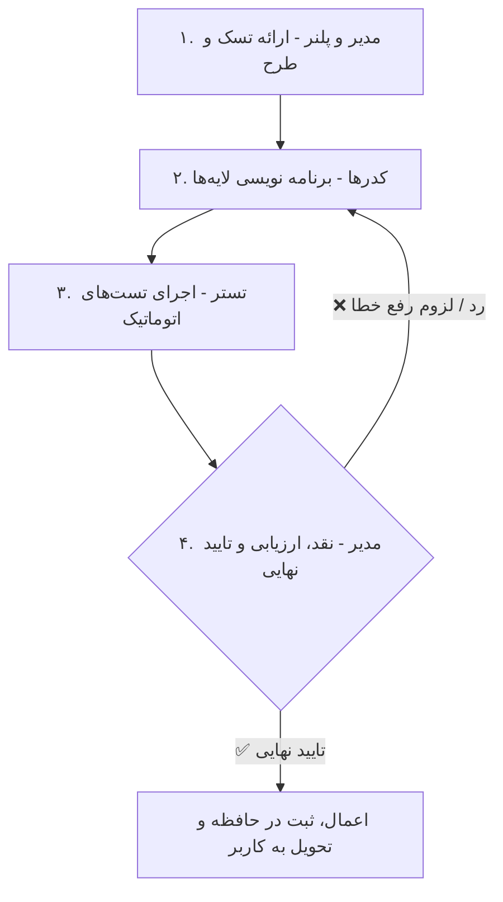

# Agent Loop System & Execution Lifecycle

چرخه کاری ایجنت‌ها (Agent Loop) یک خط لوله ۴ گامه بسته و تکرارشونده همراه با **حلقه تایید و رد مدیر (Manager Review Loop)** برای هر درخواست در پروژه است.

---

## 🔄 مراحل خط لوله ترتیبی (Pipeline Lifecycle)

### ۱. گام مدیر و پلنر (Plan & Delegate)
- ایجاد طرح در `implementation_plan.md` و تعیین زیرتسک‌ها.

### ۲. گام برنامه نویسی (Code Implementation)
- توسعه کدهای لایه‌های Core, Domain, Data, DB و Presentation توسط ایجنت‌های تخصصی (Backend, Database, UI/Frontend).

### ۳. گام تست و سنجش کیفیت (QA Testing)
- ایجاد Unit Testها و Component Testها و اجرای دستورات تست و لینتر استک توسط ایجنت تستر.

### ۴. گام نقد و ارزیابی مدیر (Manager Approval Loop)
- **ارزیابی کیفی ایجنت مدیر**:
  - اگر خطا وجود داشت 👈 بازگشت به گام ۲ (کدرها) برای رفع خطا و تکرار تست.
  - اگر خطا وجود نداشت 👈 تایید نهایی، بروزرسانی حافظه دوگانه و ارائه به کاربر.
