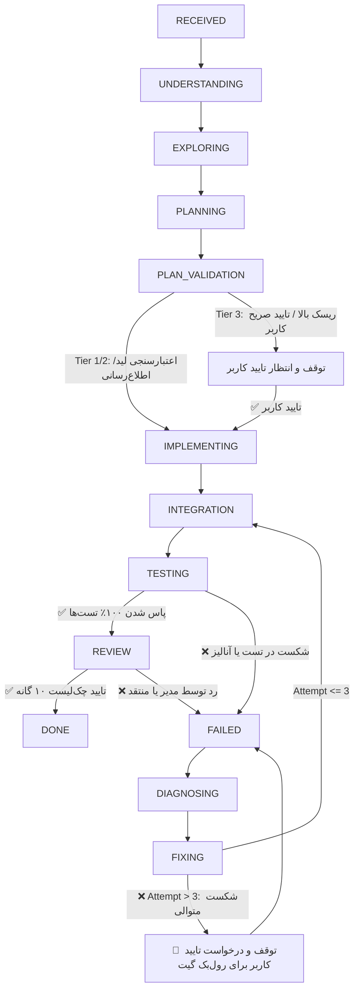

# Task State Machine Specification (10 Primary + 3 Recovery States)

این سند مشخصات فنی «ماشین حالت ۱۳ گانه تسک‌ها (Agent Task State Machine)» را تعریف می‌کند. تسک‌ها از دو دسته وضعیت شامل **۱۰ وضعیت اصلی (Primary Execution States)** برای طی مسیر موفق (Happy Path) و **۳ وضعیت بازیافت (Recovery States)** برای رفع خطا و ریکاوری استفاده می‌کنند.

---

## 📊 1. ساختار ۱۳ گانه وضعیت‌ها (10 Primary + 3 Recovery States)

```text
================================================================================
                    TASK STATE MACHINE TAXONOMY (13 STATES)
================================================================================

[PRIMARY EXECUTION STATES (10 HAPPY-PATH STATES)]
1. RECEIVED         ➔ دریافت اولیه تسک از کاربر
2. UNDERSTANDING    ➔ تحلیل عمیق نیازمندی و کانتکست
3. EXPLORING        ➔ اکتشاف کدبیس و ترسیم گراف نمادها
4. PLANNING         ➔ تدوین طرح پیاده‌سازی و چک‌لیست پذیرش
5. PLAN_VALIDATION  ➔ اعتبارسنجی طرح (Human Approval) و تخصیص تطبیقی مدل‌ها (Model Allocation Sub-Stage)
6. IMPLEMENTING     ➔ کدنویسی لایه‌ها توسط کدرها با کانفیگ مدل اختصاصی (با نقد Critic Layer)
7. INTEGRATION      ➔ یکپارچه‌سازی لایه‌ها و ثبت در DI
8. TESTING          ➔ اجرای Unit/Widget Testها توسط موتور اعتبارسنجی
9. REVIEW           ➔ بازرسی ۱۰ گانه Self-Check و تایید مدیر
10. DONE            ➔ تکمیل ۱۰۰٪ تسک و تحویل به کاربر

--------------------------------------------------------------------------------

[RECOVERY STATES (3 ERROR-HANDLING STATES)]
11. FAILED      ➔ شناسایی شکست در مرحله TESTING یا REVIEW
12. DIAGNOSING  ➔ عارضه‌یابی ریشه‌ای و استخراج تراک خطاهای عینی
13. FIXING     ➔ اصلاح کد و بازگشت ترانزیشن به INTEGRATION/TESTING
================================================================================
```

---

## 🔄 2. ترانزیشن حالت‌ها در خط لوله (State Transition Flow)



### 🔍 زیرمراحل وضعیت PLAN_VALIDATION (Sub-Stages)
1. **Sub-Stage 5.1: Governance & Human Approval Gate**: بررسی سطح ریسک بر اساس [change_impact_analyzer.md](change_impact_analyzer.md) و توقف برای تأیید صریح کاربر در تغییرات حساس Tier 3.
2. **Sub-Stage 5.2: Adaptive Model Allocation Hook**: بلافاصله پس از نهایی‌سازی و اعتبارسنجی طرح:
   - تحلیل نیازمندی‌های انتزاعی هر نقش توسط `CoreBrain` (با پشتیبان قطعی `DeterministicFallbackBrain`).
   - دیسکاوری مدل‌ها و محدودیت‌ها از طریق `ProviderAdapter` فعال (Claude Code یا Codex).
   - تخصیص پیکربندی اجرایی عینی توسط `ModelAllocator` و تزریق بلوک سبک `execution_config` به فایل‌های Handoff پیش از شروع وضعیت `IMPLEMENTING`.

---

## 📝 3. ثبت وضعیت در Working Memory

وضعیت فعال ماشین حالت باید در ابتدای فایل [working_memory.md](.agents/memory/working_memory.md) ثبت و بروزرسانی شود:

```markdown
Current Task State: PLAN_VALIDATION (Primary State 5/10)
Risk Tier: Tier 1 (Low Risk - Autonomous Approval)
Recovery Attempt: None (Primary Path)
```
