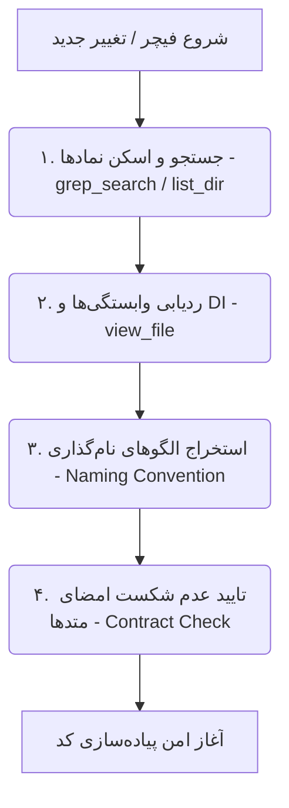

# Agent System Codebase Understanding Specification

این سند دستورالعمل جامع «فهم کدبیس (Codebase Understanding & Exploration)» را برای تمامی ایجنت‌ها تعریف می‌کند تا هر ایجنت قبل از ایجاد یا تغییر هر قطعه کد، نقشه ذهنی دقیق و کاملی از تمام بخش‌های پروژه داشته باشد.

---

## 🗺 ۱. نقشه ذهنی کدبیس پروژه (Project Mental Map)

```text
src/ (or lib/)
├── core/                        # زیرساخت‌های عمومی پروژه
│   ├── di/                      # کانتینر تزریق وابستگی و IoC
│   ├── error/                   # تعاریف استاندارد خطاها و استثناها
│   ├── network/                 # کلاینت شبکه، ارتباطات HTTP و API
│   ├── router/                  # مسیریابی و ناوبری برنامه
│   ├── theme/                   # استایل‌ها، توکن‌های طراحی و سیستم تم
│   └── types/                   # تایپ‌ها، قراردادها و اینترفیس‌های مشترک
└── features/                    # فیچرهای مستقل برنامه بر اساس معماری لایه‌ای (Clean / Modular)
    └── <feature_name>/
        ├── data/                # DataSources, DTOs, Repository Implementations
        ├── domain/              # Entities, UseCases, Repository Contracts
        └── presentation/        # Components, UI Widgets, Controllers / State Stores
```

---

## 🔎 ۲. پروتکل ۴ مرحله‌ای اکتشاف کدبیس (4-Step Code Exploration Protocol)

قبل از انجام هرگونه تغییر، ایجنت مربوطه موظف به اجرای این ۴ مرحله است:



1. **جستجو و اسکن نمادها (Symbol Search)**:
   - استفاده از `grep_search` یا `list_dir` برای پیدا کردن مدل‌ها، UseCaseها یا کامپوننت‌های مشابه موجود.
   - جلوگیری از تعریف مدل‌ها یا Entityهای تکراری.
2. **ردیابی سلسله‌مراتب وابستگی‌ها (Dependency Traversal)**:
   - ردیابی از `presentation` به `usecase` به `repository` به `datasource`.
   - چک کردن پیش‌نیازهای تزریق شده در کانتینر DI پروژه (مانند `injection.dart` یا فایل معادل فریم‌ورک).
3. **استخراج استانداردهای نام‌گذاری (Pattern Extraction)**:
   - پیروی دقیق از استانداردهای موجود در کدبیس (مانند Naming Convention پشته: `FeatureController`, `FeatureState`, `FeatureRepository`).
4. **تایید حفظ امضای متدها (Contract Safety Check)**:
   - تضمین اینکه تغییر متدها باعث شکست سایر صدازنندگان در پروژه نشود.

---

## 🛑 ۳. قوانین بازرسی کدهای موجود (Existing Code Audit Rules)

- **اصل عدم تخریب (Non-Destructive Principle)**: عدم تغییر فایل‌های موجود مگر در صورت ضرورت فیچر جاری.
- **اصل بازاستفاده پیش‌فرض (Reusability First)**: اگر ویجتی (مانند دکمه‌ها، کارت‌ها، اینپوت‌ها) در `core` یا فیچرهای قبلی وجود دارد، مجدداً ساخته نشود و بازاستفاده گردد.
- **اصل همخوانی با تست‌ها**: هر تغییر در لایه منطق یا داده باید مستقیماً با تست‌های موجود در پوشه `test/` تطبیق داده شود.
