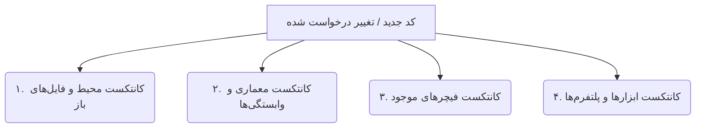

# Agent System Context Awareness Specification

این سند نحوه «فهم و تحلیلی کانتکست (Context Awareness)» توسط تمام ایجنت‌ها در پروژه را تعریف می‌کند تا هر ایجنت قبل از شروع کدنویسی یا پاسخ‌دهی، تصویر کاملی از وضعیت فعلی برنامه داشته باشد.

---

## 🧠 ۱. ابعاد چهارگانه فهم کانتکست (4-Dimensional Context Understanding)

همه ایجنت‌ها موظف هستند پیش از انجام هر کار، کانتکست پروژه را در ۴ بعد اصلی تحلیل نمایند:

### ۱. کانتکست محیط و فایل‌های باز (Workspace & Cursor Context)
- بررسی فایل فعال جاری (Active Document)، موقعیت کرسر و فایل‌های باز کاربر.
- اولویت‌دهی به ویرایش کدهایی که کاربر مستقیماً روی آن‌ها تمرکز دارد.

### ۲. کانتکست معماری و وابستگی‌ها (Core Architecture & DI Context)
- بررسی سازوکار تزریق وابستگی موجود پروژه، در صورت استفادهٔ پروژه از آن.
- استفاده مجدد از امکانات مشترک موجود پروژه برای شبکه، تم و مسیریابی، در صورت ارتباط با تسک، به جای خلق مجدد آن‌ها.
- چک کردن نسخه‌ها و پکیج‌های موجود در مانیفست پکیج‌ها (مانند `package.json`، `Cargo.toml`، `go.mod` یا `pubspec.yaml`).

### ۳. کانتکست فیچرهای موجود (Feature Domain Context)
- بررسی و حفظ ساختار واقعی ماژول‌ها و فیچرهای پروژه، بدون فرض مسیر ثابت.
- بازاستفاده از مدل‌ها، استیت‌ها و داده‌های مشترک بین فیچرها به جای کپی‌برداری کد.

### ۴. کانتکست ابزارها و پلتفرم‌ها (Cross-Platform Context)
- سنجش سازگاری پدیده جدید با پلتفرم‌های هدف (Android, iOS, Web, macOS, Windows, Linux).
- بررسی استفاده‌نشدن از APIهای منسوخ در زبان، کتابخانه‌ها و فریم‌ورک‌های مرتبط با تغییر.

---

## 🔍 ۲. قانون طلایی منع حدس کانتکست (No Guessing Rule)

- **هیچ ایجنتی مجاز به حدس زدن اسامی متدها، فیلدها یا مسیر فایل‌ها نیست.**
- قبل از استفاده یا ویرایش هر رمز/کلاس، فایل اصلی تعریف‌کننده آن باید مشاهده (`view_file` یا `grep_search`) شده و ساختار دقیق آن استخراج شود.

---

## 🔄 ۳. فرایند بررسی کانتکست قبل از کدنویسی (Pre-Execution Context Check)

1. **خواندن فایل‌های درگیر**: مشاهده کدهای فعلی لایه مربوطه (Domain/Data/Presentation).
2. **بررسی وابستگی‌ها**: اطمینان از آماده بودن وابستگی‌های مرتبط با تغییر طبق سازوکار موجود پروژه؛ اگر پروژه DI دارد، ثبت‌های مرتبط نیز بررسی شوند.
3. **تطبیق با تم موجود**: در تغییرات UI، استفاده از توکن‌ها و امکانات تم مشترک پروژه، در صورت وجود.
