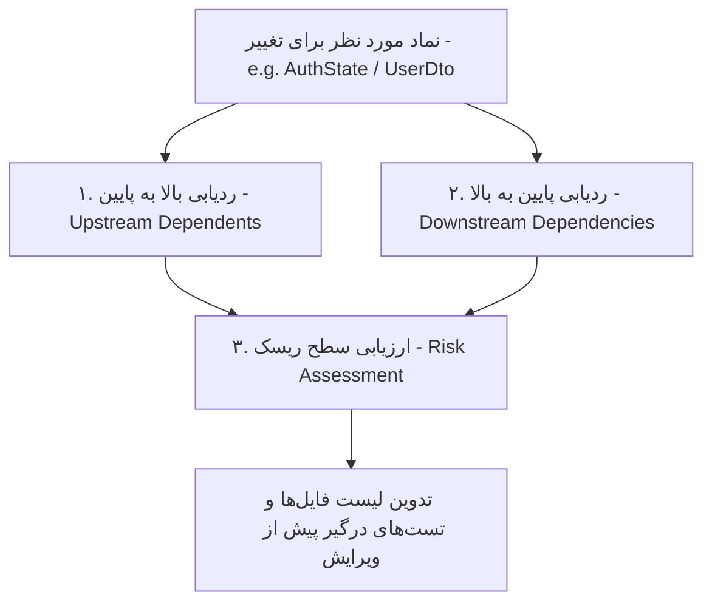

# Dependency / Symbol Graph & Impact Analysis Specification

این سند مشخصات فنی «گراف نمادها و تحلیل اثرات تغییرات (Dependency / Symbol Graph & Impact Analysis)» را تعریف می‌کند تا تمام ایجنت‌ها قبل از اعمال هرگونه ویرایش یا روتین جدید، گراف وابستگی‌های نماد را ترسیم کرده و تغییرات بالقوه (Potentially Affected Components) را پیش‌بینی نمایند.

---

## 🕸 ۱. گراف عمودی وابستگی نمادها (Vertical Dependency & Symbol Graph)

الگوی تفکیک گراف نمادها در معماری استاندارد لایه‌ای (Clean / Layered Architecture):

```text
UI Component / View Layer (e.g. LoginPage, AuthModal, UserScreen)
    │
    ▼
State / Controller Layer (e.g. AuthController, useAuthStore, AuthCubit, AuthViewModel)
    │
    ├── State Definition & DTOs (e.g. AuthState, LoginRequestDto)
    │
    ▼
Domain / UseCase Layer (e.g. LoginUseCase, AuthenticateUser, AuthService)
    │
    ▼
Repository Contract (e.g. IAuthRepository, AuthRepository Interface)
    │
    ▼
Repository Implementation (e.g. AuthRepositoryImpl)
    │
    ▼
Data Source / Network & DB Driver (e.g. ApiClient, DatabaseDriver, CacheService)
```

---

## ⚡ ۲. الگوریتم تحلیل اثرات تغییر (Impact Analysis Algorithm)

قبل از دستکاری هر نماد، ایجنت موظف به اجرای ۳ مرحله تحلیل اثرات (Impact Analysis) است:



### ۱. ردیابی وابسته به بالا (Upstream Dependents)
- **سوال**: چه کامپوننت‌ها، کنترلرها، سرویس‌ها یا لایه‌های بالادستی از این نماد استفاده می‌کنند؟
- **مثال**: اگر مدل `AuthState` یا DTO ورودی تغییر کند 👈 کنترلرهای متصل، کامپوننت‌های رندرکننده UI و سوئیت تست‌های مرتبط (`unit_test`, `component_test`) مستقیماً تحت تاثیر قرار می‌گیرند.

### ۲. ردیابی وابسته به پایین (Downstream Dependencies)
- **سوال**: این نماد خود به چه اینترفیس‌ها، مدل‌ها یا سرویس‌هایی متکی است؟

### ۳. سطح‌بندی ریسک تغییر (Impact Risk Level)
- 🟢 **Low Risk**: تغییرات داخلی بدون دستکاری امضای متدها یا Interfaceها.
- 🟡 **Medium Risk**: افزودن فیلد جدید به State یا Model (تغییرات غیرشکست‌دهنده).
- 🔴 **High Risk / Breaking**: تغییر امضای Repository، حذف فیلد یا تغییر نام متدها (نیازمند آپدیت همزمان تمام Invocation Siteها).

---

## 🛡 ۳. الزام قبل از کدنویسی (Pre-Modification Protocol)

- **هیچ کدی بدون اجرای Impact Analysis دستکاری نمی‌شود.**
- ایجنت لیست دقیق فایل‌ها و تست‌هایی که باید پس از تغییر آپدیت یا مجدداً تست شوند را استخراج می‌کند.
