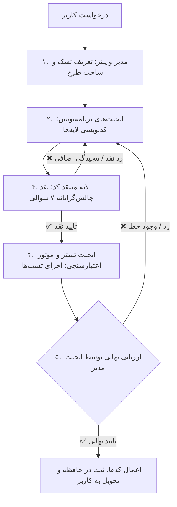

# Multi-Agent Sequential Pipeline & Manager Review Loop Specification

این سند نحوه تعامل ترتیبی و موازی ۷ نقش تخصصی ایجنت‌ها (`agent_roles.md`) را در قالب خط لوله ۵ مرحله‌ای همراه با لایه منتقد ۷ سوالی (`critic_layer.md`) مشخص می‌سازد.

---

## 🔄 خط لوله ترتیبی ۵ گام همراه با لایه منتقد ۷ سوالی و تایید مدیر

---

## 📌 تفکیک گام‌ها در خط لوله

1. **گام ۱: مدیر و پلنر (Manager & Planner)**: تدوین طرح در `implementation_plan.md` با هماهنگی `lead-agent-manager`.
2. **گام ۲: برنامه‌نویسان (Developers)**: پیاده‌سازی کدهای لایه‌ها (Backend, Database, UI/Frontend, Logic/State).
3. **گام ۳: لایه منتقد کد (Critic Layer)**: ممیزی ۷ سوالی سادگی کد (`critic_layer.md`)، عدم وجود پیچیدگی اضافی، تطبیق با معماری کلین و بررسی ایزولاسیون تست‌ها.
4. **گام ۴: تستر و زیرساخت اعتبارسنجی (QA & Verification Engine)**: نگارش و اجرای اتوماتیک آزمون‌های هدفمند و لینتر رسمی پشته پروژه بدون هیچ اثر جانبی واقعی.
5. **گام ۵: ارزیابی و تایید مدیر (Lead Manager Review)**: تایید نهایی خروجی، بروزرسانی حافظه فعال و تحویل گزارش به کاربر با رعایت قانون نگهبان گیت.

---

## 🥗 قوانین رژیم کانتکست و ایزولاسیون گام‌ها (Role-Scoped Handoff Token Diet)

جهت جلوگیری از تورم کانتکست و بهینه‌سازی مصرف توکن (به‌ویژه مهار سهم ۷۵٪ پلنر در سشن‌های طولانی):

1. **انتقال پلنر به برنامه‌نویس (Planner ➔ Coder Boundary)**:
   - پلنر پس از نهایی‌سازی طرح در `implementation_plan.md` متوقف می‌شود.
   - کلیه لاگ‌های اکتشافی، جستجوهای سراسری (`find`, `grep`) و پیام‌های میانی هرس می‌شوند.
   - برنامه‌نویس فقط: ۱) بخش مربوط به تسک خود از قرارداد `implementation_plan.md`، ۲) فایل‌های هدف، و ۳) تک اسکیل تخصصی همان لایه (مثلاً `*-ui-specialist`) را دریافت می‌کند.
2. **انتقال برنامه‌نویس به منتقد (Coder ➔ Critic Boundary)**:
   - منتقد صرفاً دیف تغییرات (`git diff`) و ۷ سوال ممیزی (`critic_layer.md`) را بررسی می‌کند؛ نیازی به حمل لاگ‌های بیلد یا متن کامل فایل‌های دست‌نخورده ندارد.
3. **انتقال منتقد به تستر (Critic ➔ Tester Boundary)**:
   - تستر صرفاً معیارهای پذیرش (Acceptance Criteria)، فایل‌های تغییریافته و اسکیل اختصاصی آزمون (`*-qa-specialist`) را دریافت می‌کند؛ نیازی به لاگ‌های اکتشافی پلنر ندارد.
4. **اصل حداقل کانتکست کافی (Minimum Sufficient Context)**:
   - هرگز کل قوانین ۲۷ گانه Core یا تمام اسکیل‌ها به ساب‌ایجنت‌ها تزریق نمی‌شوند. تزریق صرفاً تقاضامحور و با ارجاع صریح صورت می‌پذیرد.

