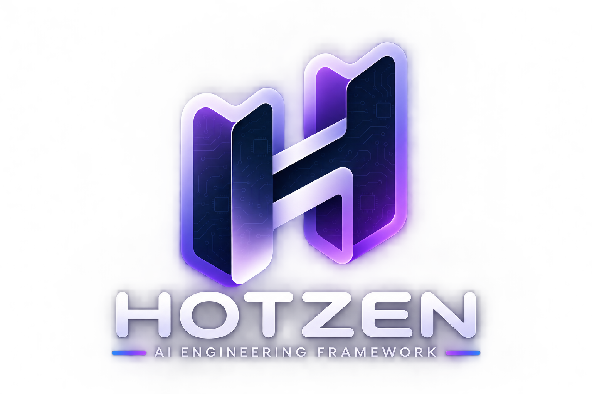
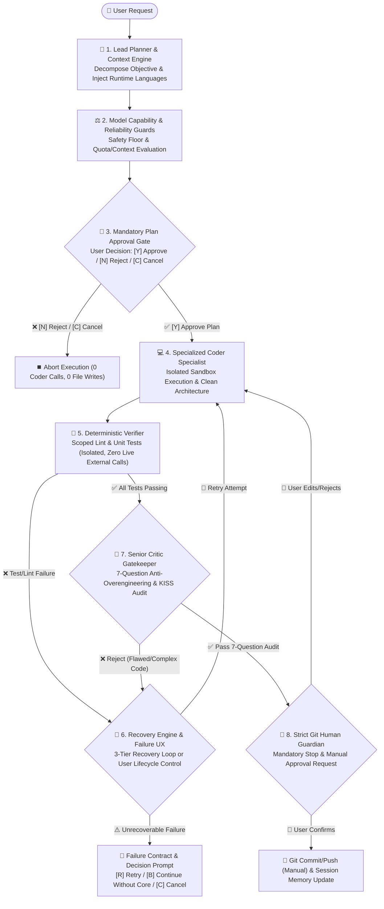

<p align="center">
  
</p>

# HOTZEN — Governed AI Engineering Framework

**0.0.2 is an unpublished experimental release candidate.** The initial
0.0.1 release is publicly available on npm, and the GitHub distribution
repository is public. Native Windows runtime is **NOT VERIFIED**.

HOTZEN deploys stack-specific skills, governance rules, and assistant bridge
files into a project. The CLI also detects project stacks and runs configured
verification checks. This GitHub repository contains the packaged distribution
files. The full development source repository is separate.

## Install and get started

The published 0.0.1 can show Model Switching status on bare `npx hotzen`.
To open its deployer explicitly, run `npx --package=hotzen@0.0.1 -- hotzen`.
The examples below target the 0.0.2 candidate. After npm publication,
`@0.0.2` selects that exact version and `@rc` selects the version tagged
`rc`.

```sh
npx hotzen@0.0.2
npx hotzen@0.0.2 --stack=flutter --bridges=codex
npx hotzen@0.0.2 --help
npx hotzen@rc
```

After 0.0.2 is promoted to `latest`, run `npx hotzen` in the intended project
to open stack detection or selection. NPX does not permanently install the CLI.
Publish future candidates with `--tag=rc`. Move `latest` only after explicit
stable-release approval.

After promotion to `latest`, the following installs the CLI into npm's
global prefix. Plain `hotzen` requires the installed executable on `PATH`.

```sh
npm install -g hotzen
hotzen --help
```

For macOS/Linux, the [GitHub tarball procedure](INSTALL.md#github-release-tarball-macoslinux)
applies once both the archive and its SHA-256 file are published. It requires
Node.js and npm and checks the release-specific digest before global installation.

After installation, check the aliases and preview a deployment in your project:

```sh
hotzen --version
core --version
agent-hub-init --version
hotzen --stack=flutter --dry-run
```

All three aliases use the same CLI. The local wrapper installers also retain
`agent-hub`. Default deployment uses bundled stacks and bridges without
implicit private GitHub access. Explicit legacy remote workflows may require
authorized access to the private repository. Existing `.agents/` paths,
memory, configuration, receipts and managed-block markers are preserved.
See [installation details](INSTALL.md) and the
[distribution procedure](docs/HOTZEN_DISTRIBUTION.md).

<div align="center">

[](INSTALL.md)
[](https://opensource.org/licenses/MIT)
[](INSTALL.md)
[](INSTALL.md)
[](INSTALL.md)
[](https://modelcontextprotocol.io/)
[](INSTALL.md)
[](INSTALL.md)

**The Universal 28-Stack Agent Governance Operating System & Senior Skill Hub for AI Pair Programming**
*Optimized for Google Antigravity, Claude Code, Cursor, OpenAI Codex, and Open-Source LLMs.*

🌐 **Language / زبان**: [🇺🇸 English](README.md) | [🇮🇷 فارسی](README_FA.md) | ⚡ **[CLI Cheatsheet](CHEATSHEET.md)**

*(Package version: 2.3.0)*

</div>


---

## 📖 Overview

**HOTZEN** is an enterprise-grade multi-agent governance framework that transforms generic AI assistants into a dedicated **5-Role Senior Engineering Team** directly inside your project.

Instead of writing shallow, hallucinated, or unmaintainable code, the AI agents in this hub strictly adhere to **Clean Architecture**, execute an adversarial **7-Question Senior Critic Gate**, verify code with automated tests, enforce a **Mandatory Pre-Execution Plan Approval Gate**, provide **Resilient Failure Lifecycle Control (Retry / Bypass / Cancel)**, and enforce an ironclad **Strict Git Human Guardian Law** preventing any unauthorized commits.

```text
agent-core-hub/
├── README.md                           👈 Comprehensive architecture guide & documentation
├── AGENTS.md                           👈 Universal Open Multi-Agent Governance Protocol
├── ROADMAP.md                          👈 Continuous Governance & Audit Roadmap
├── package.json                        👈 CLI package (npm test requires the complete development checkout)
│
├── .agents/                            👈 Active workspace agent runtime
│   ├── rules/                          👈 27 core engineering rules & state machines
│   ├── memory/                         👈 Quad-memory system & metrics.template.json
│   ├── security/                       👈 Enterprise secret leak scanner
│   └── hooks/                          👈 Git pre-commit security guardian hook
│
├── core/                               👈 Core V1 execution engine, routing & bridges
│   ├── allocation/                     👈 Model allocator, Safety Floor, switching toggle & guards
│   ├── workflow/                       👈 13-stage workflow, Plan Approval Gate & Failure UX
│   ├── languages.js                    👈 Dynamic runtime language configuration engine
│   ├── bridges/                        👈 AI Bridges (.claude, .cursor, Codex, Gemini...)
│   └── mcp/                            👈 Model Context Protocol configuration presets
│
├── stacks/                             👈 Centralized multi-stack registry (28 stacks)
│   ├── flutter/                        👈 Flutter STACK_RULES.md & skills
│   ├── react/                          👈 React 19 STACK_RULES.md & skills
│   ├── rust/                           👈 Rust 2024 STACK_RULES.md & skills
│   ├── solidity/                       👈 Solidity & EVM STACK_RULES.md & skills
│   └── ...                             👈 28 specialized stacks centralized on main
│
├── scripts/                            👈 Repository automation tooling
│   ├── sync_branches.py                👈 Automated 28-branch synchronizer
│   └── populate_stacks.py              👈 Stack registry extractor
│
└── cli/                                👈 Unified CLI engine (core & agent-hub-init) with auto-backup
```


---

## 🌿 The 28 Modular Stack Branches Matrix

HOTZEN uses a clean **Branch-Per-Stack** git architecture across **29 Git branches** (1 main root + 28 dedicated technology stacks). The `main` and `core` branches contain the lightweight, unpolluted core engine. When checking out any stack branch, specialized `.agents/skills/` and stack-specific rules are automatically activated:

```text
==================================================================================================
                           🌐 28-STACK MODULAR TECHNOLOGY ECOSYSTEM
==================================================================================================
 🏛️ Core Engine          ──► [main / core] 27 Universal Rules, Quad-Memory, MCP Bridges
 🦀 Systems & High-Perf  ──► [rust] Tokio / Axum  •  [cpp] Modern C++20/23 / RAII
 🧠 AI & Agentic LLMs    ──► [python-ai-ml] PyTorch / LangGraph / RAG / Vector DBs
 ⛓️ Web3 & Blockchain    ──► [solidity] EVM / Foundry / Hardhat / OpenZeppelin v5
 🐚 Infrastructure       ──► [bash] Advanced Bash 5.2+ / Bats-core / ShellCheck
 📱 Mobile & Native      ──► [flutter] BLoC  •  [kotlin] Jetpack Compose  •  [swift] SwiftUI
 🌐 Web & Frontend       ──► [vanilla-web] HTML/CSS/JS  •  [react] React 19  •  [react-nextjs] Next 15
                             [vue] Vue 3/Nuxt  •  [wordpress] Gutenberg & Modern PHP
 🚀 Backend & Enterprise ──► [dart-backend] Serverpod  •  [python-fastapi] Async SQLAlchemy
                             [golang] Clean Architecture  •  [java] Spring Boot 3
                             [php] Modern PSR-12  •  [laravel] Laravel 11 ADR
                             [dotnet] .NET 8/9 C#  •  [nestjs] Nest 10  •  [nodejs] Node 22 LTS
 🗄️ Database & Storage   ──► [database] PostgreSQL / Redis / pgvector / SQL Tuning
 🎮 Game Development     ──► [unity] Unity 6 C#  •  [godot] Godot 4 C#
                             [gdscript] GDScript 2.0  •  [unreal-engine] UE 5.4+ C++
==================================================================================================
```

| Category | Branch Name | Tech Stack | Active Senior Skills & Rules |
| :--- | :--- | :--- | :--- |
| **Core Engine** | **`main`** / **`core`** | 🏛️ Shared Hub Core | 27 Core Rules, Quad-Memory, MCP Servers, AI Bridges, CLI & One-Liners |
| **Systems & High-Perf** | **`rust`** | 🦀 Rust 2024 | Tokio Async, Axum, SQLx, Proptest, Criterion, Zero Unsafe |
| **Systems & High-Perf** | **`cpp`** | ⚡ Modern C++20/23 | RAII, Smart Pointers, CMake, Concepts, Ranges, GTest, ASan/TSan |
| **AI, RAG & Agents** | **`python-ai-ml`** | 🧠 AI & Agentic LLMs | PyTorch, LangGraph, RAG Pipelines, Vector DBs, Ragas Eval, VCR.py |
| **Web3 & Blockchain** | **`solidity`** | ⛓️ Solidity & EVM | Foundry, Hardhat, CEI Pattern, ReentrancyGuard, OpenZeppelin v5, Custom Errors, Gas Opt |
| **Infrastructure** | **`bash`** | 🐚 Advanced Bash 5.2+ | POSIX Compliance, `set -euo pipefail`, Bats-core Tests, ShellCheck |
| **Mobile & Native** | **`flutter`** | 📱 Flutter & Dart | Clean Architecture, BLoC, Dio, Hive, Senior Critic, QA Tests |
| **Mobile & Native** | **`kotlin`** | 📱 Kotlin & Android | Jetpack Compose, Material 3, Room, Flow Turbine, JUnit 5 |
| **Mobile & Native** | **`swift`** | 🍎 Swift 6 & iOS | SwiftUI, SwiftData, Strict Concurrency (`actor`), Swift Testing |
| **Web & Frontend** | **`vanilla-web`** | 🌐 Vanilla Web (HTML/CSS/JS) | Semantic HTML5, Modern CSS3, Vanilla JS ES6+, UI/UX, SEO, Animations |
| **Web & Frontend** | **`react`** | ⚛️ React 19 SPA | React 19, Vite, TanStack Query v5, Zustand, RTL, MSW, Vitest |
| **Web & Frontend** | **`react-nextjs`** | ⚛️ Next.js 15 Fullstack | App Router, Server Components (RSC), Zod Actions, Vitest |
| **Web & Frontend** | **`vue`** | 💚 Vue 3 & Nuxt | Vue 3 SFC, `<script setup>`, Pinia, Vue Test Utils, Vitest |
| **Web & Frontend** | **`wordpress`** | 🌐 WordPress & Gutenberg | Modular OOP Plugins (PHP 8.2+), React Blocks, Nonces, WP_Mock |
| **Backend & Enterprise** | **`dart-backend`** | 🎯 Dart Backend | Serverpod, Dart Frog, Shelf, PostgreSQL, Redis, Testing |
| **Backend & Enterprise** | **`python-fastapi`** | 🐍 Python FastAPI | FastAPI, Layered Architecture, SQLAlchemy 2.0 Async, Pytest |
| **Backend & Enterprise** | **`golang`** | 🐹 Go Standard | Clean Architecture, Gin/Fiber, Explicit Errors, Race Detector |
| **Backend & Enterprise** | **`java`** | ☕ Java & Spring Boot | Spring Boot 3, Java 21 Virtual Threads, JPA, Testcontainers |
| **Backend & Enterprise** | **`php`** | 🐘 Modern PHP & PSR | PHP 8.2+, PSR-12, OOP, PDO Prepared, Dependency Injection, PHPUnit |
| **Backend & Enterprise** | **`laravel`** | 🔴 PHP Laravel 11 | Action-Domain-Responder (ADR), Strict Types, Pest Tests |
| **Backend & Enterprise** | **`dotnet`** | 🟣 .NET 8/9 & C# 12 | CQRS, MediatR, EF Core AsNoTracking, xUnit, FluentAssertions |
| **Backend & Enterprise** | **`nestjs`** | 🦁 NestJS 10 | Hexagonal Architecture, Prisma/TypeORM, OpenAPI, Jest |
| **Backend & Enterprise** | **`nodejs`** | 🟢 Node.js 22 LTS | Fastify/Express, TypeScript, Zod Validation, Pino Logs, Vitest |
| **Database & Storage** | **`database`** | 🗄️ Database Architecture | SQL Tuning, PostgreSQL, Redis, Vector DBs (`pgvector`), EXPLAIN ANALYZE |
| **Game Development** | **`unity`** | 🎮 Unity 6 (C#) | ScriptableObject Architecture, VContainer DI, Zero GC in Update, UTF |
| **Game Development** | **`godot`** | 🤖 Godot 4 (.NET C#) | Call Down Signal Up, Scene Tree, Custom Resources, GdUnit4 |
| **Game Development** | **`gdscript`** | 🐍 Godot GDScript 2.0 | Typed GDScript 2.0, Finite State Machines, GUT Testing |
| **Game Development** | **`unreal-engine`** | ⚔️ Unreal Engine 5.4+ | C++20, Gameplay Ability System (GAS), UPROPERTY Safety, Automation |

> [!IMPORTANT]
> **Clarification of Architectural Capabilities**:
> - **Stack Installation Support**: 28 pre-configured templates delivering full architectural rules, specialized skills, and test baselines via bundled CLI deployment (e.g., Flutter, React 19, Laravel 11, Rust 2024).
> - **Runtime Language Configuration**: Dynamic per-task multi-language awareness via `core lang` (`core lang add <language>`, `core lang remove <language>`) with zero project restart, zero source file mutation, and configuration persistence in `.agents/memory/runtime_config.json` (under `languages` and `primaryLanguage`).
> - **AI Bridge & Configuration Support**: Instruction files, MCP configuration, ignore patterns, and slash commands across 14 AI environments (`gemini`, `claude`, `codex`, `cursor`, `copilot`, `windsurf`, `cline`, `aider`, `deepseek`, `qwen`, `codestral`, `ollama`, `kimi`, `opencode`).
> - **Core Provider Execution Adapters**: Dedicated execution adapters in `core/allocation/adapters/` for OpenAI Codex (`codex_adapter.js`) and Anthropic Claude Code (`claude_code_adapter.js`). Codex, Antigravity and Claude have historical real-execution evidence limited to the Tasks actually tested. Native host execution is distinct from a Core-managed Provider adapter; this evidence does not establish universal task or host coverage. The other bridges provide workspace configuration integration without implying a managed execution adapter.

---

## 🚀 Installation & Instant Deployment (How to Use)

**Start here:** [Installation and first use](INSTALL.md) defines prerequisites, the `core` command, hooks opt-in and the separate Native/Core-managed routes.

HOTZEN 2.0 introduces **Evidence-Based Stack Auto-Detection**, a system health **Doctor**, and an automated **Verification Engine**. You can deploy into any project with zero configuration.

> [!TIP]
> ⚡ **Quick Reference Cheatsheet**: Looking for a complete cheat sheet with all commands, flags, and matrix options? Check out the **[Universal CLI Cheatsheet](CHEATSHEET.md)** (یا [نسخه فارسی چیت‌شیت](CHEATSHEET_FA.md)).

---

### ⚡ Mode 1: Smart Auto-Detect (*Recommended - Zero Config*)

Simply navigate to your project directory and run:

```bash
npx hotzen@0.0.2
```

The CLI automatically inspects your project manifests (`composer.json` for Laravel, `pubspec.yaml` for Flutter, `package.json` for React/Next/Vue/Nest, `Cargo.toml` for Rust, `go.mod` for Go, etc.) and prompts:

```text
======================================================================
🌐 HOTZEN — Governed AI Engineering Framework - NPX Instant Deployer
======================================================================
🔍 Auto-Detected Tech Stack: laravel (95% confidence)
   Evidence: composer.json (laravel/framework)
----------------------------------------------------------------------
Press [Enter] to use detected stack 'laravel'
Or type a stack name / number [1-28] below:
```

Press **Enter** to deploy governance rules, skills, fresh memory and bridges. Hook files can be copied, but activating the pre-commit guardian requires explicit `--install-hooks`; an existing custom hooks path is preserved unless `--force-hooks` is requested.

---

### 🛠️ Mode 2: Manual Selection (Explicit Stacks)

If you want to manually specify one or more stacks (or override auto-detection):

```bash
# Explicit single stack:
npx hotzen@0.0.2 --stack=flutter
npx hotzen@0.0.2 --stack=laravel

# Composable multi-stack (e.g., Next.js frontend + Database architecture):
npx hotzen@0.0.2 --stack=react-nextjs,database

# Safe preview without modifying files on disk:
npx hotzen@0.0.2 --dry-run
```

---

### 🩺 System Doctor, Verification Engine & Subcommands

HOTZEN CLI includes built-in diagnostics and verification tools:

| Command | Purpose | Example |
| :--- | :--- | :--- |
| `npx hotzen@0.0.2` | Auto-detects stack and deploys with **Enter** confirmation | `npx hotzen@0.0.2` |
| `npx hotzen@0.0.2 detect` | Scans project and displays detected technology & confidence score | `npx hotzen@0.0.2 detect` |
| `npx hotzen@0.0.2 doctor` | Inspects Git status, security hooks, active AI bridges, and governance rules | `npx hotzen@0.0.2 doctor` |
| `npx hotzen@0.0.2 verify` | Runs automated verification matrix (lint, type-check where configured, tests) for current stack | `npx hotzen@0.0.2 verify` |
| `npx hotzen@0.0.2 reset` | Purges installed skills from `.agents/skills` to reset accidental stack choices | `npx hotzen@0.0.2 reset` |
| `npx hotzen@0.0.2 bridge <name>` | Deploys only bridge configuration for a specific AI agent (`cursor`, `claude`, `all`) | `npx hotzen@0.0.2 bridge cursor` |
| `core switch` | Shows frozen OFF status and the active Safety Floor | `core switch` |
| `core switch on` | Blocked in V1. Saved preferences are unchanged | `core switch on` |
| `core switch off [model]` | Leaves saved preferences unchanged and does not select a fixed model | `core switch off` or `core switch off [model]` |
| `core lang` | Displays primary detected language and active runtime project languages | `core lang` |
| `core lang add <lang>` | Adds a language dynamically for future tasks (persisted in `.agents/memory/runtime_config.json`) | `core lang add python` |
| `core lang remove <lang>` | Removes a secondary runtime language from future tasks safely | `core lang remove python` |
| `core run "<task>"` | Runs workflow with mandatory pre-execution plan approval and resilient failure recovery | `core run "Build user cart API"` |

---

### 🔄 Branch Synchronization & Drift Detection
The CLI recognizes 28 stack identifiers. Each stack bundles its rules and specialized skills under `stacks/<identifier>/`. Default deployment selects those local resources without private GitHub access. Language-specific branches in the private development repository are not needed for public installation. Explicit legacy remote workflows may require authorized private access.

The following branch synchronization commands apply only to the separate complete private development source checkout:

- **Check Drift Across All 28 Branches**:
  ```bash
  npm run check-drift
  # Or directly via Python:
  # Complete development source checkout only (script absent from this distribution)
  python3 scripts/sync_branches.py --drift
  ```
- **Synchronize Branches**:
  ```bash
  # Complete development source checkout only
  python3 scripts/sync_branches.py --dry-run  # Preview changes
  python3 scripts/sync_branches.py            # Apply sync locally
  ```
  *(Note: Synchronizing branches and pushing to origin is strictly governed by the Git Human Guardian Law and requires explicit user confirmation).*

---


### 📦 Method 1: Supported npm/local installation

From your project, use the exact npm version once 0.0.2 is published:

```sh
npx hotzen@0.0.2
```

On macOS/Linux, if the installed executable is on `PATH`, you can run
`hotzen` or `hotzen --stack=laravel` instead.

---

### 🧩 Composable Multi-Stack / Polyglot Deployments

Need a full-stack environment combining multiple technologies (e.g. **PHP Backend + Modern HTML/CSS/JS Frontend + Database Architecture**)? You can compose and merge multiple stacks simultaneously using a comma-separated list:

```bash
# In interactive mode, type stack numbers separated by comma without spaces (e.g. 4,15):
Enter number(s) or name(s) separated by comma [explicit selection required; no default]: 4,15

# Or type stack names separated by comma:
Enter number(s) or name(s) separated by comma [explicit selection required; no default]: react,laravel

# Via NPX flag:
hotzen --stack=php,vanilla-web,database

# Via installed HOTZEN:
hotzen --stack=python-fastapi,react,database
```

#### What happens during Multi-Stack deployment?
- **Unified Core & Memory**: Deploys the 27 universal governance rules, 4-tier quad-memory, and AI bridge files (`GEMINI.md`, `CLAUDE.md`, `CODEX.md`, `AGENTS.md`, `.mcp.json`).
- **Skill Merging**: Gathers specialized senior skills from all specified stacks into `.agents/skills/` without conflicts.
- **Combined Architecture Rules**: Synthesizes the architecture guidelines of each selected stack into a unified `.agents/AGENTS.md` and `STACK_RULES.md`.
- **🛡️ Auto-Backup & Safety**: Automatically creates `<filename>.bak.<timestamp>` for any differing existing files.
- **🔍 Dry-Run Support**: Allows running with `--dry-run` to preview all file additions safely.

---

### 🛡️ Safety & Dry-Run Simulation Mode (`--dry-run`)

Before making any modifications to your repository, you can safely simulate the deployment with `--dry-run`. In dry-run mode:
- Preview deployment without applying changes to the target project. Temporary staging files or directories may be created.
- **Accurate Preview**: The tool logs every file that would be generated or backed up (`[DRY-RUN] Would create: ...` or `[DRY-RUN] Would backup & overwrite: ... -> .bak`).

```bash
# Preview via NPX (Zero-Install):
hotzen --dry-run
hotzen --stack=react,database --dry-run

# Preview via installed HOTZEN (macOS & Linux):
hotzen --dry-run
hotzen --stack=flutter --dry-run

# Preview via installed local CLI:
hotzen --stack=rust --dry-run
hotzen bridge cursor --dry-run
```

#### ⚙️ CLI Flags & Parameters Reference

| Flag | Type | Description | Example |
| :--- | :--- | :--- | :--- |
| `--dry-run` | Flag | Preview deployment without applying changes to the target project | `--dry-run` |
| `--stack=<name>` | String | Comma-separated list of target stacks (28 available) | `--stack=react,laravel` |
| `--bridges=<list>` | String | Comma-separated AI bridges to install (`all`, `cursor`, `copilot`, etc.) | `--bridges=cursor,copilot` |
| `--global`, `-g` | Flag | Legacy Bash deployer global mode; public npm uses npm install --global | `--global` |
| `--help`, `-h` | Flag | Display CLI options, stacks, and bridges help | `--help` |
| `bridge <name>` | Subcommand | Deploy only bridge files for a specific IDE/agent | `hotzen bridge cursor` |


---

### 🔹 Legacy private workflow: Direct Git Clone

Legacy only: requires separately authorized private repository access; this is not a public installation method. Obtain the actual repository URL from its owner before substituting the placeholder:
```bash
# 1. Clone the desired branch
git clone -b flutter <authorized-private-repository> my-flutter-app

# 2. Enter project and start pair programming
cd my-flutter-app
```

---

### 🔹 Method 3: Local CLI Tool (`core`)

To install the CLI permanently on your machine (delegates to the unified Node engine):
* **macOS / Linux:** `bash cli/install-mac-linux.sh`
* **Run anywhere after PATH setup:** `core` (aliases: `agent-hub`, `agent-hub-init`). These wrappers reference the source directory; keep it in place. Existing unrelated `core` commands are protected. See [first-use and PATH details](INSTALL.md).

---

### 🔹 Legacy private workflow: Git Submodule

Legacy only: requires separately authorized private repository access and an owner-supplied URL; this is not a public installation method:
```bash
git submodule add <authorized-private-repository> .agent-core
```

---

## 🔄 How to Switch Stacks in Any Project

#### 1. In Authorized Legacy Private Checkouts:
If the checkout contains the stack branches, switch to the desired branch:
```bash
git checkout react          # Switches to React 19
git checkout python-fastapi # Switches to FastAPI
git checkout unity          # Switches to Unity 6
```

#### 2. In Existing Projects via NPX:

After 0.0.2 is published to npm, rerun the pinned command in the project
directory with the new stack. Deployment merges the selected skills into
`.agents/skills/`. Skills from an earlier deployment can remain.

```bash
npx hotzen@0.0.2 --stack=rust
```

- Under `.agents/`, deployment adds or updates rules, skills, hook and scanner
  files, and MCP configuration. It initializes missing memory files and
  preserves existing ones.
- At the project root, deployment creates missing `AGENTS.md`, `.mcp.json`,
  and `STACK_RULES.md` or updates their managed content. It creates
  `.gitignore` if missing or appends missing ignore rules to an existing file.
- The selected bridges add or update their own files, such as `CODEX.md` and
  `.codexignore` for Codex. When the CLI changes an existing file through a
  backed-up copy or merge, it saves the previous content as
  `<file>.bak.<timestamp>`. The `.gitignore` update appends rules without
  creating a backup.

#### 3. In Fullstack / Monorepo Projects:

After 0.0.2 is published to npm, run each command from the directory it targets:

- Project root: `npx hotzen@0.0.2 --stack=react-nextjs`
- `backend/`: `npx hotzen@0.0.2 --stack=laravel`

---

## 🆙 Update with npm/local HOTZEN; legacy private Git workflows

Whenever new core rules, AI bridges (such as Cursor, DeepSeek, Qwen), or specialized skills are released to `agent-core-hub`, you can effortlessly update your existing projects using any of the following methods:

---

### 1️⃣ Method 1: Using NPX (Zero-Install & Instant)
Use NPX to deploy the bundled resources for the selected npm version. With the GitHub tarball installed, use `hotzen` with the same arguments:
```bash
# Interactive menu update:
npx hotzen@0.0.2

# Update with a specific stack flag:
npx hotzen@0.0.2 --stack=flutter

# Multi-stack update:
npx hotzen@0.0.2 --stack=react-nextjs,laravel

# Safely preview update changes first (no deployment changes to the target project):
npx hotzen@0.0.2 --stack=flutter --dry-run
```

---

### 2️⃣ Method 2: Using installed HOTZEN (macOS/Linux)
Run the installed CLI directly inside your project directory:

* **macOS & Linux (installed CLI):**
  ```bash
  # Interactive mode:
  hotzen

  # Direct stack update:
  hotzen --stack=flutter

  # Safely preview update changes first:
  hotzen --stack=flutter --dry-run
  ```

---

### 3️⃣ Legacy private workflow: Git (Clone, Branch, Submodule & Subtree)

* **Direct Git Clone Projects:**
  Pull the latest upstream branch changes:
  ```bash
  git pull origin <stack-branch-name>
  # Example:
  git checkout flutter && git pull origin flutter
  ```

* **Git Submodule Projects:**
  Fetch and merge upstream commits:
  ```bash
  git submodule update --remote --merge
  ```

* **Git Subtree Projects:**
  Pull upstream changes into your `.agents` or prefix folder:
  ```bash
  git subtree pull --prefix=.agents <authorized-private-repository> main --squash
  ```

---

### 4️⃣ Method 4: Using Installed Local CLI (`agent-hub-init`)
If you installed the CLI on your machine:
```bash
cd /path/to/your/project
hotzen --stack=flutter
```

---

> [!TIP]
> **🛡️ Source Code Safety Guarantee:**
> Updating only refreshes the `.agents/` rules, skills, and AI bridge files (`.cursorrules`, `CURSOR.md`, `CLAUDE.md`, `DEEPSEEK.md`, `QWEN.md`, `GEMINI.md`, etc.). Your application source code is **never modified or deleted**.
>
> *Best Practice:* If you have written custom project notes in `.agents/memory/project_memory.md`, commit your working tree before running an update.

---

## ⚡ Core V1 Runtime Capabilities

HOTZEN V1 introduces an intelligent, autonomous execution layer that bridges high-level planning, dynamic model routing, and safety-critical execution gates directly inside your workspace:

```text
┌────────────────────────────────────────────────────────────────────────────────────────┐
│ 🧠 CORE V1 RUNTIME ARCHITECTURE                                                        │
├────────────────────────────────────────────────────────────────────────────────────────┤
│  1. 🌐 Runtime Languages ──► core lang (add / remove dynamically with zero restart)   │
│  2. ⚖️ Model Switching status ──► core switch (frozen OFF + Safety Floor)│
│  3. 🛡️ Reliability Guards ──► Quota & context window health checks (OK/WARN/CRITICAL)  │
│  4. 🛑 Plan Approval Gate ──► Mandatory user approval before ANY implementation/write  │
│  5. 🧪 Isolated Verifier ──► Scoped tests, zero external side-effects (offline & mock)│
│  6. 🧐 Senior Critic Gate ──► 7-question adversarial KISS & anti-overengineering audit │
│  7. 🚨 Failure Lifecycle ──► Structured failure contract: [R]etry / [B]ypass / [C]ancel│
│  8. 🛑 Git Human Guardian ──► Zero automated commits/pushes without explicit permission│
└────────────────────────────────────────────────────────────────────────────────────────┘
```

---

### 🌐 1. Dynamic Runtime Language Management (`core lang`)

While stack templates deploy pre-configured skills and architecture rules, projects often evolve polyglot requirements (such as adding Python scripts to a React workspace, or embedding Rust in a Go microservice). `core lang` manages runtime language awareness per project without modifying source files or re-running installers:

* **Inspect Active Languages**:
  ```bash
  core lang
  ```
  *Output:*
  ```text
  Project Languages

  - TypeScript
  - Python

  Primary: TypeScript
  ```

* **Add an Additional Runtime Language**:
  ```bash
  core lang add python
  core lang add rust
  ```
  Instantly persists in `.agents/memory/runtime_config.json` (under keys `languages`, `primaryLanguage`, and `updatedAt`), updates future task planning context, requires **zero project restart**, and modifies **zero project source files**.

* **Remove a Secondary Language**:
  ```bash
  core lang remove python
  ```
  Safely disables the secondary language for future tasks. Core protects against accidental project breakage by refusing to remove the detected primary language or the sole active language.

* **Smart Aliasing**: Automatically resolves common shorthands (`py` ➔ `Python`, `js` ➔ `JavaScript`, `ts` ➔ `TypeScript`, `rs` ➔ `Rust`, `kt` ➔ `Kotlin`, `rb` ➔ `Ruby`).

---

### ⚖️ 2. Model Switching status and Safety Floor (`core switch`)

`core switch` shows the current status. Automatic Model Switching is frozen
OFF in V1. `core switch on` is blocked, and `core switch off [model]` does
not select a fixed model. Neither operation changes saved preferences.
The Safety Floor remains active and enforces model capability requirements
for high-risk tasks.

---

### 🛑 3. Mandatory Pre-Execution Plan Approval Gate (`core run`)

When executing an engineering task via `core run "<task>"` (aliases: `core task "<task>"`, `core "<task>"`), Core halts before a single line of implementation code is written or modified, displaying a complete, transparent execution plan:

```text
======================================================================
📋 PROPOSED EXECUTION PLAN (AWAITING APPROVAL)
======================================================================
Task: Implement optimistic cart checkout with SQLite persistence
Target Languages: TypeScript, SQL

Minimum Viable Team & Role Allocations:
  - Lead Planner:     Lightweight Model (e.g. gpt-5.6-luna / provider-selected)
  - Coder Specialist: Strong Model (e.g. gpt-6-astra / provider-selected)
  - Senior Critic:    Deterministic / Strong Model

Reliability & Context Health:
  - Context Window: OK (provenance: estimated)
  - Quota Health:   OK (model available)

Proposed Implementation Steps:
  1. Define CartEntity and CartRepository interfaces in domain/
  2. Implement SQLiteCartDataSource with atomic transaction support
  3. Wire UI presentation layer with optimistic state updates
  4. Execute isolated unit and integration tests with mocked SQLite driver
======================================================================
Execution Plan Ready:
  [Y] Approve & Execute Plan
  [N] Reject Plan (No Changes Made)
  [C] Cancel
Choice:
```

* **Interactive & Non-Interactive Execution**:
  * **Interactive Mode**: Halts and prompts `[Y] Approve / [N] Reject / [C] Cancel`.
  * **Non-Interactive Automation**: Supports CLI flags `--approve` (`-y`), `--reject` (`-n`), or `--cancel` (`-c`) for automated scripting.

* **Ironclad Invariants**:
  1. **Pre-Execution Write Guarantee**: Before explicit user approval (`[Y] Approve`), Core guarantees **0 Coder implementation calls**, **0 Recovery implementation calls**, and **0 project/source implementation writes**. Planning metadata (such as the proposed plan snapshot) may be safely stored in Core sandbox/task metadata.
  2. **Plan Snapshot Integrity**: Execution executes the exact approved plan snapshot without silent modification.
  3. **Stale Plan Invalidation**: If runtime settings (such as `core switch` or `core lang`) change before approval, the plan is marked stale and must be re-planned (`STALE_PLAN_INVALIDATED`).
  4. **Post-Approval Safety Stop**: If safety conditions change after approval (e.g. quota exhausted or safety floor violation), Core stops safely with `SAFETY_CONDITION_CHANGED_REAPPROVAL_REQUIRED` without silent provider switching.

#### 🛡️ Context Window & Quota Health Subsystem
Core monitors context window and quota health before role execution:
- **Health Classifications**: `OK`, `WARNING`, `CRITICAL`, `UNKNOWN`.
- **Data Provenance**: Categorized as `exact` (explicitly reported by provider), `estimated` (calculated from accumulated tokens and known window ceilings), or `unavailable`.
- **Explicit Limitations**:
  - Provider CLIs (such as Claude Code and OpenAI Codex CLIs) do not natively expose authoritative remaining context window percentages; Core does not invent fabricated percentages.
  - Automatic fresh-session rollover is currently **not supported** by provider adapters.
  - Under `CRITICAL` context condition, Core halts execution safely (`CONTEXT_WINDOW_CRITICAL`) to avoid hallucination or context overflow rather than claiming guaranteed overflow prevention.
  - Core does not claim guaranteed context-overflow prevention.

---

### 🚨 4. Resilient Failure Lifecycle Control (Retry / Bypass / Cancel)

When Core encounters an unrecoverable condition (e.g., provider quota exhaustion, unavailable model, or recovery loop limit reached), it emits structured diagnostics and yields explicit control back to the user:

* **Structured Failure Contract**:
  Core emits structured diagnostic data conforming to `buildFailureContract` in `core/workflow/failure_ux.js`:
  ```json
  {
    "status": "FAILED",
    "failureCode": "MODEL_QUOTA_EXHAUSTED",
    "stage": "Allocation",
    "message": "The requested model cannot be executed because account or provider quota is exhausted.",
    "details": "The selected model has no usable quota or account usage limits have been reached.",
    "retryable": false,
    "retryUnavailableReason": "Account or model quota exhausted.",
    "bypassAllowed": true,
    "projectStateSafe": true,
    "projectState": "Safe",
    "suggestedAction": "Continue without Core or configure a different model."
  }
  ```

* **Verified Contract Fields**:
  - `status`: Always `'FAILED'` upon controlled halt.
  - `failureCode`: Standardized code (e.g. `MODEL_QUOTA_EXHAUSTED`, `MODEL_UNAVAILABLE`, `NO_USABLE_MODEL_AVAILABLE`, `CONTEXT_WINDOW_CRITICAL`, `SAFETY_CONDITION_CHANGED_REAPPROVAL_REQUIRED`, `STALE_PLAN_INVALIDATED`, `PROVIDER_EXECUTION_FAILED`, `UNRECOVERABLE_TIMEOUT`, `PLANNER_FAILED`, `CODER_EXECUTION_FAILED`, `MAX_ATTEMPTS_EXCEEDED`, `RECOVERY_STAGNATION`, `VERIFICATION_FAILED`, `CORE_INTERNAL_FAILURE`).
  - `stage`: Current workflow stage (`Planning`, `Awaiting Approval`, `Allocation`, `Coder`, `Verification`, `Critic`, `Recovery`, `Delivery`).
  - `message`: High-level explanation of the failure.
  - `details`: Diagnostic or technical error context.
  - `retryable`: Boolean indicating if automatic retry is permitted.
  - `retryUnavailableReason`: Detailed explanation if retry is not available (e.g. fatal verification failure or exhausted quota).
  - `bypassAllowed`: Always `true` (users are never locked into Core).
  - `projectStateSafe`: Boolean indicating whether project source code is unmodified.
  - `projectState`: `'Safe'` (0 source writes) or `'Has partial modifications'`.
  - `suggestedAction`: Recommended next step for the user.

* **User Choice Options**:
  ```text
  ==================================================
  CORE FAILURE
  ==================================================

  Core could not continue.

  Stage: Allocation
  Reason: MODEL_QUOTA_EXHAUSTED
  Details: The selected model has no usable quota or account usage limits have been reached.
  Project state: Safe

  What would you like to do?

  Retry unavailable: Account or model quota exhausted.
  [B] Continue without Core
  [C] Cancel
  Choice:
  ```
  1. **`[R] Retry with Core`**: Re-evaluates provider availability and re-attempts execution (up to maximum retry limits).
  2. **`[B] Continue without Core (Bypass)`**: Marks task as `BYPASSED`. Core makes **zero further provider calls**, leaving your project and native tooling (`npm`, `cargo`, `flutter`, `pytest`) completely intact with zero lock-in.
  3. **`[C] Cancel`**: Cleanly terminates the task with status `CANCELLED` and makes zero further calls.

---

### 🏛️ 5. Project Independence & Clean Git State

* **Repository Cleanliness**: Core operates inside your project without creating unauthorized commits or altering git history.
* **Local Session Cache**: Telemetry and execution history are maintained locally in `.agents/memory/database.sqlite` (gitignored, with 0 rows committed to repository history).
* **Non-Destructive Safety**: Any configuration updates automatically generate `<file>.bak.<timestamp>` backups to prevent accidental data loss.

---

## 👁️ Visual Workflow & Real-World Scenarios

HOTZEN operates as an intelligent, deterministic multi-stage pipeline with strict pre-execution and pre-commit safety gates:



---

### 📱 Scenario 1: Mobile Development (Flutter / Kotlin / Swift)
> 💬 **User Request**: *"Add a cart checkout screen that reads items from the offline database and has a pay button."*

```text
┌────────────────────────────────────────────────────────────────────────────────────────┐
│ 📱 Mobile Scenario Execution Cycle                                                     │
├────────────────────────────────────────────────────────────────────────────────────────┤
│ 1. 👑 Lead Planner: Formulates plan, resolves models ➔ Plan Approval Gate ➔ User [Y]. │
│ 2. 🗄️ Database Specialist: Defines cart model in Room/Hive with reactive Flow/Stream. │
│ 3. 🎨 UI Specialist: Builds Compose/BLoC screen with Material 3 stateless widgets.    │
│ 4. 🧐 Senior Critic (7-Question Gate): Audits:                                         │
│    - Is recomposition optimized? ✅                                                    │
│    - Did database logic leak into UI layer? (No, Clean Architecture preserved) ✅      │
│    - Are tests isolated with zero live external side-effects? ✅                       │
│ 5. 🧪 QA Specialist: Writes ComposeTestRule / Widget test with mocked local DB.       │
│ 6. 🛑 Git Guardian: STOPS: "Changes ready. Do you approve committing to git?"          │
└────────────────────────────────────────────────────────────────────────────────────────┘
```

---

### 🌐 Scenario 2: Web & Frontend (React 19 / Next.js / Vue)
> 💬 **User Request**: *"Build a live search filter for the products table querying server API."*

```text
┌────────────────────────────────────────────────────────────────────────────────────────┐
│ ⚛️ Frontend Scenario Execution Cycle                                                   │
├────────────────────────────────────────────────────────────────────────────────────────┤
│ 1. 👑 Lead Planner: Formulates plan, resolves models ➔ Plan Approval Gate ➔ User [Y]. │
│ 2. 🧠 State Specialist: Implements TanStack Query v5 cache (avoids manual state sync). │
│ 3. 🎨 UI Specialist: Creates search input with custom useDebounce & skeleton loading.  │
│ 4. 🧐 Senior Critic (7-Question Gate): Audits:                                         │
│    - Are redundant useEffect hooks used? (No, server state handled by query) ✅         │
│    - Is WAI-ARIA accessibility compliant? ✅                                           │
│    - Are API network calls mocked via MSW with zero live requests? ✅                  │
│ 5. 🧪 QA Specialist: Mocks API server with MSW (Mock Service Worker) and tests 400s.   │
│ 6. 🛑 Git Guardian: Displays modified files and waits for your manual confirmation.   │
└────────────────────────────────────────────────────────────────────────────────────────┘
```

---

### 🐘 Scenario 3: Backend & Enterprise (Laravel / Go / FastAPI / .NET)
> 💬 **User Request**: *"Build a payment webhook endpoint that credits user wallet on success."*

```text
┌────────────────────────────────────────────────────────────────────────────────────────┐
│ 🚀 Backend Scenario Execution Cycle                                                    │
├────────────────────────────────────────────────────────────────────────────────────────┤
│ 1. 👑 Lead Planner: Classifies as Tier 3 ➔ Plan Approval Gate ➔ User Approves [Y].     │
│ 2. 🚀 Backend Developer: Implements credit logic inside a dedicated Action/Service.    │
│ 3. 🗄️ Database Specialist: Wraps credit mutations inside DB Transaction with Lock.    │
│ 4. 🧐 Senior Critic (7-Question Gate): Audits:                                         │
│    - Is double-spending prevented? (Handled via DB pessimistic lock & idempotency) ✅  │
│    - Is webhook HMAC signature validated? ✅                                           │
│    - Are external payment calls strictly mocked/intercepted in test suite? ✅          │
│ 5. 🧪 QA Specialist: Runs concurrency race tests and mock gateway assertions.         │
│ 6. 🛑 Git Guardian: STOPS and presents diff for your explicit manual permission.       │
└────────────────────────────────────────────────────────────────────────────────────────┘
```

---

### 🦀 Scenario 4: Systems & AI (Rust / C++ / Python AI-ML)
> 💬 **User Request**: *"Implement a semantic RAG search pipeline for corporate PDF documents."*

```text
┌────────────────────────────────────────────────────────────────────────────────────────┐
│ 🧠 Systems & AI Scenario Execution Cycle                                               │
├────────────────────────────────────────────────────────────────────────────────────────┤
│ 1. 👑 Lead Planner: Records token budget & VRAM limits ➔ Plan Approval Gate ➔ User [Y].│
│ 2. 🧠 AI/RAG Specialist: Builds recursive chunker and Qdrant dense vector search.      │
│ 3. ⚡ Core Developer: Enforces Pydantic structured outputs & GPU memory cleanup.       │
│ 4. 🧐 Senior Critic (7-Question Gate): Audits:                                         │
│    - Are prompts hallucinating without source citations? (Guardrails verified) ✅      │
│    - Is GPU VRAM freed on batch completion? ✅                                         │
│    - Are vector DB tests isolated with synthetic local fixtures? ✅                    │
│ 5. 🧪 QA Specialist: Evaluates Ragas benchmark (Faithfulness > 85%, Relevancy > 85%).  │
│ 6. 🛑 Git Guardian: Halts and awaits explicit manual approval before committing.       │
└────────────────────────────────────────────────────────────────────────────────────────┘
```

---

### 🎮 Scenario 5: Game Development (Unity / Godot / Unreal Engine)
> 💬 **User Request**: *"Build a projectile weapon system spawning bullets from an Object Pool dealing damage."*

```text
┌────────────────────────────────────────────────────────────────────────────────────────┐
│ 🎮 Game Development Scenario Execution Cycle                                           │
├────────────────────────────────────────────────────────────────────────────────────────┤
│ 1. 👑 Lead Planner: Routes to Route D ➔ Plan Approval Gate ➔ User Approves [Y].        │
│ 2. 🕹️ Gameplay Developer: Creates firing controller with Enhanced Input & Raycasts.   │
│ 3. 🏛️ Architecture Specialist: Builds Object Pooler & ScriptableObject event channels. │
│ 4. 🧐 Senior Critic (7-Question Gate): Audits:                                         │
│    - Is `Instantiate` or `new` called in `Update()`? (No, pooled objects reused) ✅    │
│    - Are `GetComponent` calls cached in `Awake`? ✅                                     │
│    - Are PlayMode tests isolated with zero network/file dependencies? ✅               │
│ 5. 🧪 QA Specialist: Runs PlayMode tests asserting bullet returns to pool on impact.  │
│ 6. 🛑 Git Guardian: Halts and awaits manual approval to commit game assets/scripts.   │
└────────────────────────────────────────────────────────────────────────────────────────┘
```

---

## 🛡️ Enterprise Invariants & System Capabilities

| Capability | Technical Mechanism | Enforcement Level |
| :--- | :--- | :--- |
| **🔒 Enterprise Secret Leak Guardian** | Python scanner (`security_scanner.py`) inspecting Git Staged Blobs | **Hard Block** (pre-commit hook exits code 1) |
| **🚫 Blocked File Extensions & .env** | Regex `r"^\.env(\..+)?$"` blocks all `.env` variants (.production, .staging, .local) | **Hard Block** |
| **🔑 High-Precision API Key Regex** | Regex for Anthropic (`sk-ant-api03-...`), OpenAI, AWS, Google AI, GitHub | **Hard Block & Masked Logs** |
| **🛡️ Safe Non-Destructive Deployment** | CLI & one-liners create `<file>.bak.<timestamp>` when overwriting existing files | **Automatic Backup** |
| **🔍 Simulation Mode** | Flag `--dry-run` allows risk-free preview of all file modifications | **Read-Only Inspection** |
| **🛑 Mandatory Plan Approval Gate** | Pre-execution freeze requiring user approval before Coder invocations (0 writes on reject/cancel) | **Hard Pre-Execution Gate** |
| **⚖️ Model Safety Floor** | Enforces model capability requirements on high-risk tasks | **Architectural Invariant** |
| **🚨 Resilient Failure UX** | Structured failure contracts with explicit user choices (`[R]etry`, `[B]ypass`, `[C]ancel`) | **Zero Lock-in Contract** |
| **🌐 Runtime Language Engine** | Dynamic per-task multi-language support (`core lang`) without project restart or file damage | **Non-Destructive CLI** |
| **🏛️ Workspace & Cache Isolation** | Zero repository history pollution; local SQLite database (`database.sqlite`) remains local & gitignored | **Strict Repository Hygiene** |
| **🧪 Automated Test Suite** | Source checkout only: `npm test` runs `test/cli.test.js`, which is absent from this distribution | **Current release gate requires separate evidence** |
| **🤖 True Tool Path Conformance** | Native `.claude/settings.json` (`permissions.deny`), `.claude/commands/`, Cursor `.cursor/rules/*.mdc` | **Tool Native Enforcement** |
| **🌐 Open Multi-Agent Standard** | Root `AGENTS.md` protocol recognized across Codex, Claude, Cursor, Antigravity | **Universal Standard** |
| **🏛️ Hybrid Centralized Architecture** | Centralized `stacks/` registry (28 stacks on `main`) + automated synchronizer (`scripts/sync_branches.py`) | **Deterministic Maintenance** |
| **📉 Token Diet & Context Pruning** | Lean always-on core (~7.8KB, measured via scripts/measure_core.sh), dynamic on-demand loading of rules and skills via MVT | **Prompt Caching Stable** |

---

## ⚡ Core V1 Architectural Engines & Subsystems

1. **🚦 Task Routing Engine & Minimum Viable Team (MVT)**:
   * Tasks are never broadcasted to all agents. A 12-dimensional risk matrix selects the minimal team (`Route A` to `Route E`), significantly reducing token consumption by pruning unnecessary agent contexts and loading skills strictly on-demand.

2. **🧐 Senior Critic Layer (Adversarial Gatekeeper)**:
   * Enforces the KISS (Keep It Simple, Stupid) principle and validates 7 stack-specific quality questions before code reaches testing:
     1. **Requirement Solving**: Does this code genuinely solve the core requirement without shifting the premise?
     2. **Architectural Alignment**: Are SOLID principles and clean architectural boundaries (Domain/Data/Presentation) strictly preserved?
     3. **Over-Engineering Audit**: Were unnecessary abstractions, excessive utility wrappers, or premature optimizations introduced?
     4. **Convention Compliance**: Are naming conventions, project patterns, and existing standards faithfully maintained?
     5. **Regression & Risk**: Does this change risk introducing hidden side-effects or regressions in other layers?
     6. **KISS Simplicity**: Is this the simplest, cleanest, and most maintainable solution possible?
     7. **Test Isolation & Zero Side-Effects**: Are tests fully isolated, scoped/targeted, and strictly free of live external side-effects (No Live External Calls)?

3. **📊 13-State Machine Engine**:
   * Deterministic workflow tracking from `RECEIVED` to `DONE` with 3 recovery tiers and automated git rollback on catastrophic errors.

4. **🧠 Quad-Memory Architecture & Repository Isolation**:
   * `working_memory.md`: Active context & resume checkpoint.
   * `session_memory.md`: Granular session interaction logs.
   * `project_memory.md`: Permanent architectural specification.
   * `decision_memory.md`: Architecture Decision Records (ADR).
   * **Project Boundary Isolation**: Memory files are strictly scoped to the host repository. The deployer initializes clean-slate templates with zero cross-project history leakage (`.agents/memory/*.local.md` & `.agents/tasks/` are gitignored).

5. **🤖 Modular On-Demand AI Bridges (Clean Root Architecture)**:
   * **Open Multi-Agent Standard**:
     - **`AGENTS.md`**: Root protocol for multi-agent coordination (OpenAI Codex, Claude Code, Antigravity, Cursor).
   * **Core Defaults (Big 3 - Always Deployed)**:
     - **`GEMINI.md`**: Specialized for **Google Antigravity** & Gemini models with On-Demand token diet.
     - **`CLAUDE.md`**: Native Claude Code integration with `.claude/settings.json` (`permissions.deny`) & `.claude/commands/` (`/route`, `/plan`, `/critic`, `/verify`).
     - **`CODEX.md`**: Tailored for OpenAI Codex models.
   * **On-Demand Bridges Catalog (`core/bridges/`)**:
     - **`cursor`**: `CURSOR.md`, `.cursorrules`, modern `.cursor/rules/*.mdc` (with `globs`), `.cursor/mcp.json`.
     - **`copilot`**: `.github/copilot-instructions.md` (GitHub Copilot for VS Code, JetBrains, Web).
     - **`windsurf`**: `WINDSURF.md`, `.windsurfrules`, `.windsurfignore` (Windsurf IDE / Codeium Cascade).
     - **`cline`**: `CLINE.md`, `.clinerules` (Cline & Roo Code Autonomous Agents).
     - **`aider`**: `AIDER.md`, `.aider.conf.yml`, `.aiderignore` (Aider CLI Pair Programming).
     - **`deepseek`**: `DEEPSEEK.md`, `.deepseekignore` (DeepSeek-R1 / DeepSeek-V3 reasoning models).
     - **`qwen`**: `QWEN.md`, `.qwenignore` (Alibaba Cloud Qwen 2.5 Coder).
     - **`codestral`**: `CODESTRAL.md`, `.codestralignore` (Mistral Codestral / Devstral).
     - **`ollama`**: `OLLAMA.md`, `.ollamaignore` (Local offline LLMs via Ollama, LM Studio, vLLM).
     - **`kimi`**: `KIMI.md`, `.kimiignore` (Moonshot AI Kimi).
     - **`opencode`**: `OPENCODE.md`, `.opencodeignore` (Local open-source models).
   * **How to Add Bridges to your Project**:
     ```bash
     # Add during installation:
     npx hotzen@0.0.2 --stack=flutter --bridges=cursor,copilot

     # Or add anytime to an existing project:
     npx hotzen@0.0.2 bridge cursor
     npx hotzen@0.0.2 bridge copilot
     ```

6. **⚖️ Model Capability & Non-Negotiable Safety Floor (`core/allocation/`)**:
   * Evaluates task risk to apply model capability requirements.
   * **Safety Floor**: High-risk tasks (Clean Architecture, database mutations, security) are strictly prohibited from executing on lightweight models, preserving code quality even when switching is turned off.
   * V1 status: automatic switching is frozen OFF. Use `core switch` to view status.

7. **🛑 Mandatory Pre-Execution Plan Approval Gate (`core/workflow/plan_display.js`)**:
   * Pre-execution freeze: Planning, model allocation, token budgets, and context window health checks complete before code execution begins.
   * User decision: `[Y] Approve`, `[N] Reject`, `[C] Cancel`. Guarantees 0 Coder implementation calls, 0 Recovery implementation calls, and 0 project/source implementation writes before explicit approval. Planning metadata may be safely stored in Core sandbox/task metadata. Stale plans auto-invalidate upon runtime configuration drift.

8. **🧪 Isolated Deterministic Verifier (`core/verifier/`)**:
   * Runs targeted, scoped checks (linters, syntax checks, unit tests) directly related to modified files.
   * **Zero Live External Side-Effects (Absolute Red Line)**: All network, SMS, email, payment, and webhook drivers are strictly mocked or nullified during automated verification.

9. **🚨 Resilient Failure Lifecycle Control (`core/workflow/failure_ux.js`)**:
   * Whenever an unrecoverable failure occurs, Core emits structured diagnostics and offers explicit user choices (`[R] Retry with Core`, `[B] Continue without Core (Bypass)`, `[C] Cancel`).
   * Guarantees zero project lock-in: Bypassing Core leaves the project in a clean, working state with standard native toolchains.

10. **🌐 Runtime Language Management Engine (`core/languages.js`)**:
    * Dynamically configures active project languages per task (`core lang`, `core lang add <lang>`, `core lang remove <lang>`) with zero project restart, persisting in `.agents/memory/runtime_config.json`, automatic manifest detection, and alias normalization.

11. **🗄️ Local Session Cache & Telemetry (`core/allocation/execution_history_store.js`)**:
    * Maintains local session telemetry and execution history in `.agents/memory/database.sqlite` (gitignored, with 0 rows committed to repository history).

---

## 🛡️ Enterprise Security & Strict Git Human Guardian

### 🛑 Strict Git Human Guardian Law (Mandatory)
> [!CAUTION]
> **Git Law #1**: No agent is permitted to execute `git commit`, `git push`, `git merge`, or alter changelogs autonomously.
> Agents MUST present the modified files (`git status`) and proposed commit message, then STOP and wait for explicit manual human approval.

### 🔒 Enterprise Secret & Vulnerability Scanner
* Automated pre-commit hook (`.agents/hooks/pre-commit`) and scanner script (`.agents/security/security_scanner.py`).
* Scans for leaked API keys (OpenAI, Anthropic, AWS, Stripe, GitHub Tokens) and blocks accidental `.env` or private key commits.

---

## 🔌 Model Context Protocol (MCP) Integration

Pre-configured, plug-and-play MCP servers in `.agents/mcp_config.json`:

| MCP Server | Integration Target | Capabilities |
| :--- | :--- | :--- |
| **`postgres`** | PostgreSQL Server | Safe schema inspection & live `EXPLAIN ANALYZE` without guessing |
| **`sqlite`** | SQLite Database | Direct local database querying for mobile/desktop apps |
| **`docker`** | Docker Engine | Container lifecycle inspection, service logs & auto-debugging |
| **`github`** | GitHub API | Inspect issues, pull requests, and commit diffs cleanly |
| **`fetch`** | Web Documentation | Real-time web fetching for latest official package documentation |
| **`memory`** | Knowledge Graph | Long-term knowledge graph persistence across extended sessions |

---

## 📊 Empirical Benchmarking & Verified Metrics

Rather than unmeasured marketing comparisons, HOTZEN's orchestration and governance behaviors were evaluated in empirical calibration benchmarks comparing three tested execution modes on OpenAI Codex:

- **Mode A (`RAW_STRONG`)**: Direct, unorchestrated execution using a strong reasoning model (`gpt-6-astra`).
- **Mode B (`CORE_FIXED_STRONG`)**: Core Workflow Engine orchestration with all model roles locked to the strong reasoning model (`gpt-6-astra`).
- **Mode C (`CORE_ADAPTIVE`)**: Core Workflow Engine orchestration with dynamic per-role model switching (`gpt-5.6-luna` for lightweight planning/exploration, `gpt-6-astra` for coder implementation and recovery).

### 📈 Calibration Benchmark Results (3-Task Suite)

Pass criteria require full functional test pass (`testsPassed === testsTotal`) and zero fatal rubric violations.

| Execution Mode | Verified Success Rate | Avg Quality Score (0–100) | Total Tokens | Provider Calls | Duration |
| :--- | :---: | :---: | :---: | :---: | :---: |
| **`RAW_STRONG`** | **66.7%** (2/3) | **91.0** | **72,933** | 3 | ~329.8s |
| **`CORE_FIXED_STRONG`** | 33.3% (1/3) | 57.7 | 123,763 | 8 | ~671.3s |
| **`CORE_ADAPTIVE`** | **66.7%** (2/3) | **91.0** | 148,164 | 9 | ~703.5s |

#### 🔍 Empirical Findings & Objective Conclusions
1. **Quality & Correctness Parity**: `CORE_ADAPTIVE` matched `RAW_STRONG` in quality score (91.0) and task success rate (66.7%) in this bounded calibration suite.
2. **Resource & Efficiency Trade-offs**: Efficiency or token cost improvement was **not demonstrated** in this benchmark. `CORE_ADAPTIVE` required more tokens (148,164 vs. 72,933) and greater execution duration (~703.5s vs. ~329.8s) due to orchestrator stages (Planner handoffs, Senior Critic audits, and multi-turn Recovery loops).
3. **Primary Value of Core Hub**: Core Hub is designed for **governance guarantees** (mandatory human plan approval before implementation, isolated deterministic verification without live external calls, resilient failure handling, and strict Git human authorization), not token reduction.

### 🛡️ Adversarial Verifier Integrity: Rate Limiter Benchmark Case Study

To test verifier and rubric honesty against fatal violations, a challenging Rate Limiter task was evaluated across all three modes:

| Mode | Functional Tests Passed | Rubric & Fatal Violation Assessment | Official Quality Score | Outcome |
| :--- | :---: | :--- | :---: | :---: |
| **`RAW_STRONG`** | 4 / 6 | Partial functional pass, no fatal security flaw | 90 | **FAIL** (Incomplete) |
| **`CORE_FIXED_STRONG`** | 2 / 6 | Fatal rubric violation (security flaw detected) | 0 | **FAIL** (Fatal Violation) |
| **`CORE_ADAPTIVE`** | 2 / 6 | Fatal rubric violation (security flaw detected) | 0 | **FAIL** (Fatal Violation) |

> [!NOTE]
> This case study illustrates honest verifier and rubric behavior: when a fatal security violation or incomplete test pass occurs, the scoring system refuses to issue a false-positive pass and strictly zeros the quality score. It proves objective scoring integrity rather than universal Core superiority.

### 🔬 Verified Invariants & Test Coverage

In the separate complete development source checkout, the test inventory includes **33 offline test suites** comprising **170+ automated test cases** in `test/`:

1. **CLI Automation Suite** (60 automated test cases in `test/cli.test.js`): Auto-detection across 28 stacks, system health doctor checks, scoped quality verification, safe non-destructive file operations, and CLI command dispatch.
2. **Plan Approval Gate Suite** (16 automated test cases in `test/plan_approval_gate.test.js`): Enforces that before explicit `[Y] Approve`, Core executes 0 Coder implementation calls, 0 Recovery implementation calls, and 0 project/source implementation writes. On `[N] Reject` or `[C] Cancel`, execution terminates cleanly without mutating project files.
3. **Failure Lifecycle & Bypass Suite** (14 automated test cases in `test/failure_recovery_ux.test.js`): Enforces structured failure contracts and verifies that selecting `[B] Continue without Core (Bypass)` makes zero further provider calls and leaves native developer tooling (`npm`, `cargo`, `flutter`, `pytest`) intact.
4. **Safety Floor & Switching Invariants** (11 test cases in `test/safety_floor.test.js` and 14 test cases in `test/runtime_model_switching_toggle.test.js`): Guarantees that high-risk architectural and security tasks strictly route to strong models, even when model switching is toggled off.
5. **Runtime Language Management Suite** (11 automated test cases in `test/core_lang_cli.test.js`): Validates that `core lang add` and `core lang remove` mutate zero project source files and persist state safely in `.agents/memory/runtime_config.json`.
6. **Reliability & Telemetry Guards** (17 test cases in `test/reliability_guards.test.js` and 10 test cases in `test/telemetry_integrity.test.js`): Validates context health assessments (`OK`, `WARNING`, `CRITICAL`), quota safety, and uncorrupted token telemetry accounting.

---

## ❓ Troubleshooting & Operational FAQ

### Q1: What happens if I reject or cancel an execution plan?
Core halts immediately. Zero coder calls are made, zero source files are created or modified, and your working tree remains pristine. You can refine your prompt or re-run anytime.

### Q2: What happens if an AI provider runs out of quota or encounters an API error?
Core halts gracefully, displays a structured failure contract (`MODEL_QUOTA_EXHAUSTED`), and presents three explicit choices:
* `[R] Retry with Core`: Re-attempts execution once provider quota or service is restored.
* `[B] Continue without Core (Bypass)`: Deactivates Core agents for the task and leaves your workspace in a clean state, allowing you to proceed with standard tools without delay.
* `[C] Cancel`: Cleanly terminates the task with zero lingering processes.

### Q3: How do I manage polyglot workspaces without re-running stack deployers?
Use `core lang add <language>` (e.g., `core lang add python`) to add secondary runtime language awareness dynamically. It updates future planning context without modifying any source files or requiring a workspace restart.

### Q4: Can Core commit code to Git autonomously?
**No. Absolutely not.** Under the ironclad **Strict Git Human Guardian Law**, no agent is permitted to execute `git commit`, `git push`, `git merge`, or `git rebase` autonomously. All modifications must be presented via `git status` for your explicit manual confirmation.

### Q5: How can I preview file modifications before running an installer or update?
Pass the `--dry-run` flag to any deployment or update command (e.g., `npx hotzen@0.0.2 --dry-run` or `hotzen --dry-run`). Preview deployment without applying changes to the target project. Temporary staging files or directories may be created.

---

## 🤝 Contributing
1. Fork and create a branch from `core`: `git checkout -b feature/my-stack core`
2. Add your stack skills and rules under `.agents/skills/` and `.agents/AGENTS.md`.
3. Submit a Pull Request.

---

## 📄 License
Released under the **MIT License**. Free for personal, commercial, and enterprise use.
