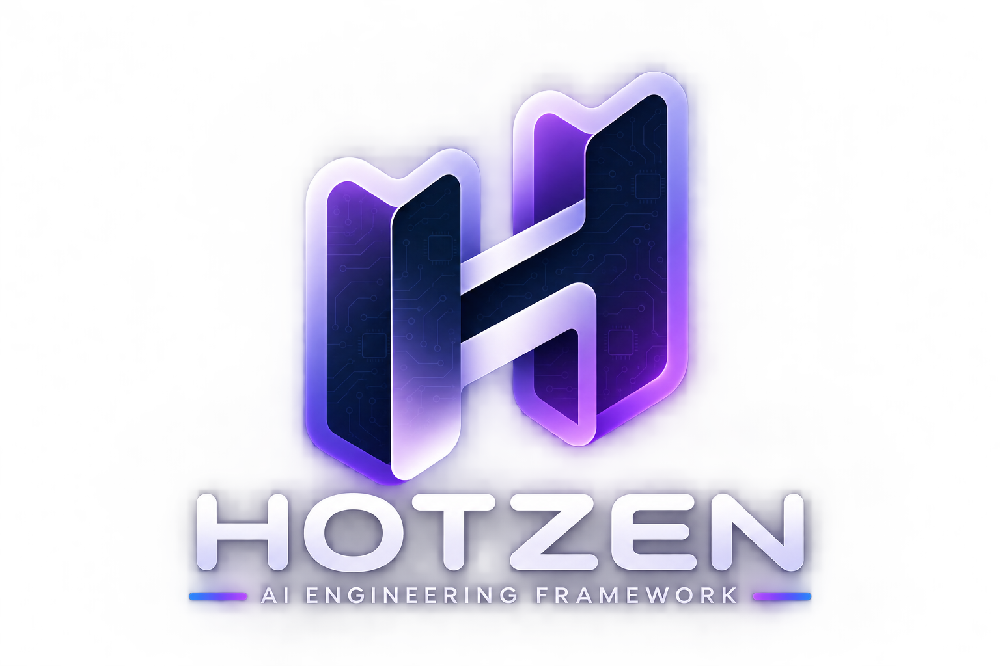
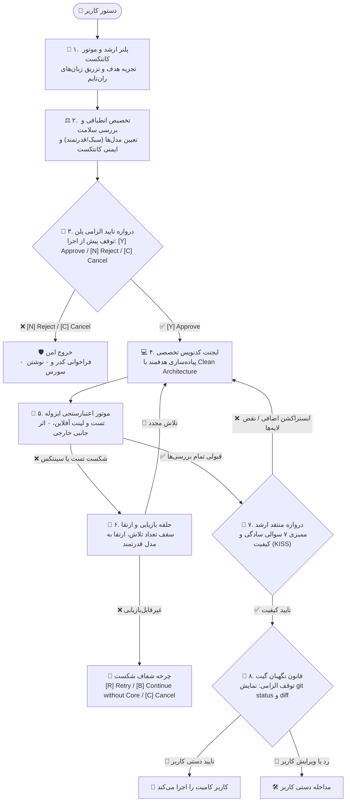

<p align="center">
  
</p>

# HOTZEN — Governed AI Engineering Framework

**۰٫۰٫۲ نامزد انتشار آزمایشی و منتشرنشده است.** نسخهٔ اولیهٔ 0.0.1
به‌صورت عمومی در npm در دسترس است و مخزن توزیع GitHub عمومی است.
اجرای بومی روی ویندوز **تأیید نشده است (NOT VERIFIED)**.

HOTZEN مهارت‌های ویژهٔ هر پشته، قواعد حاکمیتی و فایل‌های اتصال به دستیارهای
هوش مصنوعی را در پروژه مستقر می‌کند. ابزار خط فرمان پشتهٔ پروژه را نیز تشخیص
می‌دهد و بررسی‌های تعریف‌شده را اجرا می‌کند. این مخزن GitHub فایل‌های بستهٔ
توزیع را در بر دارد. مخزن کامل کد منبع توسعه جداست.

## نصب و شروع کار

در نسخهٔ منتشرشدهٔ 0.0.1، اجرای `npx hotzen` بدون آرگومان ممکن است وضعیت
سوییچینگ مدل‌ها را نشان دهد. برای باز کردن نصب‌کنندهٔ تعاملی همان نسخه،
`npx --package=hotzen@0.0.1 -- hotzen` را اجرا کنید. مثال‌های زیر برای نامزد
0.0.2 هستند. پس از انتشار در npm، `@0.0.2` همان نسخهٔ دقیق و `@rc` نسخهٔ
دارای برچسب `rc` را انتخاب می‌کند.

```sh
npx hotzen@0.0.2
npx hotzen@0.0.2 --stack=flutter --bridges=codex
npx hotzen@0.0.2 --help
npx hotzen@rc
```

پس از انتقال 0.0.2 به برچسب `latest`، در پوشهٔ پروژه `npx hotzen` را
برای تشخیص یا انتخاب پشته اجرا کنید. NPX ابزار را به‌صورت دائمی نصب نمی‌کند.
نامزدهای بعدی را با `--tag=rc` منتشر کنید. انتقال `latest` فقط پس از تأیید
صریح انتشار پایدار انجام می‌شود.

پس از انتقال به `latest`، دستور زیر ابزار را در پیشوند سراسری npm نصب
می‌کند. فرمان سادهٔ `hotzen` فقط وقتی اجرا می‌شود که فایل اجرایی نصب‌شده
در `PATH` باشد.

```sh
npm install -g hotzen
hotzen --help
```

برای macOS و Linux، [روش نصب آرشیو GitHub](INSTALL.md#github-release-tarball-macoslinux)
پس از انتشار هر دو فایل آرشیو و SHA-256 قابل استفاده است. این روش به
Node.js و npm نیاز دارد و پیش از نصب سراسری، هش آرشیو همان نسخه را بررسی می‌کند.

پس از نصب، نام‌های فرمان را بررسی کنید و پیش‌نمایش استقرار را در پروژه ببینید:

```sh
hotzen --version
core --version
agent-hub-init --version
hotzen --stack=flutter --dry-run
```

هر سه نام به یک ابزار خط فرمان اشاره می‌کنند. نصب‌کننده‌های محلی نام
`agent-hub` را هم حفظ می‌کنند. استقرار پیش‌فرض از پشته‌ها و فایل‌های اتصال
همراه بسته استفاده می‌کند و به‌طور ضمنی به مخزن خصوصی GitHub وصل نمی‌شود.
روش‌های قدیمی که دسترسی راه دور را صریحاً درخواست می‌کنند ممکن است به دسترسی
مجاز به مخزن خصوصی نیاز داشته باشند. مسیرهای `.agents/`، حافظه، تنظیمات،
رسیدها و نشانه‌های بلوک مدیریت‌شده حفظ می‌شوند. جزئیات در
[راهنمای نصب](INSTALL.md) و [روش آماده‌سازی توزیع](docs/HOTZEN_DISTRIBUTION.md)
آمده است.

<div align="center">

[](INSTALL.md)
[](https://opensource.org/licenses/MIT)
[](INSTALL.md)
[](INSTALL.md)
[](INSTALL.md)

🌐 **Language / زبان**: [🇺🇸 English](README.md) | [🇮🇷 فارسی](README_FA.md) | ⚡ **[چیت‌شیت دستورات (Cheatsheet)](CHEATSHEET_FA.md)**

*(نسخه پکیج: 2.3.0)*

</div>

> **HOTZEN — Governed AI Engineering Framework** یک اکوسیستم استاندارد، مقیاس‌پذیر و مستقل از زبان برای مدیریت، ارکستراسیون و حاکمیت ایجنت‌های هوش مصنوعی (مانند Google Antigravity، Claude Code، Cursor، Windsurf، OpenAI Codex و مدل‌های محلی) در انواع پشته‌های فناوری است.

---

## 🎯 چرا این فریم‌ورک؟ (حل چالش‌های کلیدی)

ایجنت‌های هوش مصنوعی بدون ساختار حاکمیتی دچار سه مشکل بزرگ می‌شوند:
1. **اتلاف شدید توکن و هزینه بالا**: ارسال تمام فایل‌ها و وظایف به مدل، بدون فیلتر کانتکست.
2. **کدنویسی بیش از حد (Over-Engineering)**: ساخت پترن‌های پیچیده و غیرضروری برای مسائل ساده.
3. **فراموشی کانتکست بین سشن‌ها**: از دست رفتن تصمیمات معماری (ADR) و تاریخچه تصمیم‌گیری‌ها.

**HOTZEN** این مشکلات را با **معماری ۵ موتوره**، **سیستم حافظه ۴‌گانه (Quad-Memory)** و **طراحی ماژولار برنچ‌محور** به طور کامل حل می‌کند.

---

## 🏛️ ساختار مخزن و پوشه‌ها

نمای زیر مربوط به نسخهٔ کامل مخزن توسعه است. اسکریپت‌های توسعه و پوشهٔ آزمون‌ها در بستهٔ عمومی وجود ندارند.

```text
agent-core-hub/
├── README.md                           👈 راهنمای جامع معماری و استانداردهای فریم‌ورک
├── README_FA.md                        👈 مستندات کامل فارسی
├── AGENTS.md                           👈 پروتکل استاندارد بین‌ابزاری (Open Multi-Agent Standard)
├── ROADMAP.md                          👈 نقشه راه حاکمیتی و ممیزی فنی
├── package.json                        👈 بستهٔ خط فرمان (اجرای npm test فقط در مخزن کامل توسعه)
│
├── .agents/                            👈 ساختار فعال ایجنت‌ها در ورک‌اسپیس
│   ├── rules/                          👈 ۲۷ قانون مهندسی، موتورهای اجرایی و ماشین وضعیت
│   ├── memory/                         👈 سیستم حافظه ۴‌گانه و metrics.template.json
│   ├── security/                       👈 اسکنر پیشرفته نشت امنیتی پایتون
│   └── hooks/                          👈 هوک امنیتی گیت (pre-commit)
│
├── core/                               👈 پل‌ها و الگوهای MCP مستقل از زبان
│   ├── bridges/                        👈 پل‌های رسمی هوش مصنوعی (Claude, Cursor, Codex, Gemini...)
│   └── mcp/                            👈 الگوهای پیکربندی پروتکل MCP
│
├── stacks/                             👈 رجیستری متمرکز ۲۸ پشته فناوری در شاخه main
│   ├── flutter/                        👈 قوانین STACK_RULES.md و اسکیل‌های ارشد فلاتر
│   ├── react/                          👈 قوانین و اسکیل‌های React 19
│   ├── rust/                           👈 قوانین و اسکیل‌های Rust 2024
│   ├── solidity/                       👈 قوانین و اسکیل‌های Solidity & EVM
│   └── ...                             👈 تمام ۲۸ استک به صورت متمرکز در main
│
├── scripts/                            👈 ابزارهای اتوماسیون مخزن
│   ├── sync_branches.py                👈 همگام‌ساز خودکار ۲۸ شاخه گیت
│   └── populate_stacks.py              👈 استخراج‌کننده پشته‌ها
│
└── cli/                                👈 ابزار اجرای ایمن NPX (agent-hub-init) با بکاپ خودکار
```


---

## 🌿 ماتریس ۲۸ پشته فناوری تخصصی و ۲۹ شاخه گیت (Modular Branching Strategy)

ابزار خط فرمان HOTZEN شناسهٔ ۲۸ پشته را می‌پذیرد. قواعد و مهارت‌های تخصصی هر پشته در `stacks/<identifier>/` همراه بسته قرار دارند و استقرار پیش‌فرض از همین منابع محلی استفاده می‌کند. شاخه‌های اختصاصی مخزن خصوصی توسعه برای نصب عمومی لازم نیستند. روش‌های قدیمی دریافت راه دور فقط با درخواست صریح اجرا می‌شوند و ممکن است به دسترسی مجاز به مخزن خصوصی نیاز داشته باشند. نمای شاخه‌ها و دستورهای همگام‌سازی زیر فقط به مخزن کامل و خصوصی توسعه مربوط‌اند:

```text
==================================================================================================
                        🌐 چارت جامع دسته‌بندی ۲۸ پشته فناوری (Technology Ecosystem)
==================================================================================================
 🏛️ هسته مشترک (Core)   ──► [main / core] ۲۷ قانون حاکمیتی، حافظه ۴‌گانه، سرورهای MCP و پل‌های AI
 🦀 سیستمی و پرسرعت      ──► [rust] راست و توکیو  •  [cpp] سی‌پلاس‌پلاس ۲۰/۲۳ مدرن و RAII
 🧠 هوش مصنوعی و داده   ──► [python-ai-ml] پای‌تورچ، لنگ‌گراف، RAG و پایگاه‌های برداری
 ⛓️ وب۳ و بلاکچین        ──► [solidity] سالیدیتی، ماشین مجازی اتریوم (EVM)، Foundry و OpenZeppelin
 🐚 اتوماسیون زیرساخت    ──► [bash] شل اسکریپت پیشرفته Bash 5.2+ و آزمون‌های Bats
 📱 موبایل و نیتیو       ──► [flutter] فلاتر و BLoC  •  [kotlin] کاتلین و کامپوز  •  [swift] سویفت ۶ و SwiftUI
 🌐 وب و فرانت‌اند       ──► [vanilla-web] وب خالص  •  [react] ری‌اکت ۱۹  •  [react-nextjs] نکست ۱۵
                             [vue] ویو ۳ و ناکست  •  [wordpress] وردپرس و گوتنبرگ
 🚀 بک‌اند و انترپرایز   ──► [dart-backend] دارت سرور  •  [python-fastapi] فست‌ای‌پی‌آی پایتون
                             [golang] گو استاندارد  •  [java] جاوا اسپرینگ بوت ۳
                             [php] پی‌اچ‌پی مدرن  •  [laravel] لاراول ۱۱
                             [dotnet] دات‌نت ۸/۹  •  [nestjs] نست‌جی‌اس ۱۰  •  [nodejs] نود ۲۲
 🗄️ دیتابیس و ذخیره‌سازی ──► [database] پستگرس، ردیس، pgvector و تیونینگ کوئری‌ها
 🎮 ساخت بازی و شبیه‌ساز ──► [unity] یونیتی ۶  •  [godot] گودو سی‌شارپ
                             [gdscript] گودو اسکریپت ۲  •  [unreal-engine] آنریل انجین ۵.۴
==================================================================================================
```

| دسته‌بندی | نام برنچ (Branch) | پشته فناوری | اسکیل‌ها و قوانین فعال‌شده |
| :--- | :--- | :--- | :--- |
| **هسته (Core)** | **`main`** / **`core`** | 🏛️ هسته مشترک | ۲۷ قانون مهندسی هسته + Quad-Memory + سرورهای MCP + پل‌های AI + ابزار CLI |
| **سیستمی و پرسرعت** | **`rust`** | 🦀 زبان راست | Rust 2024, Tokio Async, Axum, SQLx, Proptest, Criterion |
| **سیستمی و پرسرعت** | **`cpp`** | ⚡ سی‌پلاس‌پلاس مدرن | Modern C++20/23, RAII, CMake, Concepts, Ranges, GTest, ASan |
| **هوش مصنوعی و یادگیری** | **`python-ai-ml`** | 🧠 هوش مصنوعی و RAG | PyTorch, LangGraph, RAG Pipelines, Vector DBs, Ragas, VCR |
| **وب۳ و بلاکچین** | **`solidity`** | ⛓️ سالیدیتی و EVM | Foundry, Hardhat, CEI Pattern, ReentrancyGuard, OpenZeppelin v5, Gas Opt |
| **اتوماسیون زیرساخت** | **`bash`** | 🐚 شل اسکریپت پیشرفته | Bash 5.2+, POSIX, Bats-core Tests, ShellCheck, Linux Auto |
| **موبایل و نیتیو** | **`flutter`** | 📱 فلاتر و دارت | Clean Architecture, BLoC, Dio, Hive, Senior Critic, QA |
| **موبایل و نیتیو** | **`kotlin`** | 📱 کاتلین و اندروید | Jetpack Compose, Material 3, Room, Flow Turbine, JUnit 5 |
| **موبایل و نیتیو** | **`swift`** | 🍎 سویفت و آی‌او‌اس | Swift 6, SwiftUI, SwiftData, Swift Concurrency, Testing |
| **فرانت‌اند و وب** | **`vanilla-web`** | 🌐 وب کلاسیک و مدرن (HTML/CSS/JS) | HTML5 سمانتیک، CSS3 مدرن، جاوااسکریپت خالص، UI/UX، سئو و انیمیشن |
| **فرانت‌اند و وب** | **`react`** | ⚛️ ری‌اکت ۱۹ SPA | React 19, Vite, TanStack Query, Zustand, RTL, Vitest |
| **فرانت‌اند و وب** | **`react-nextjs`** | ⚛️ نکست‌جی‌اس Fullstack | Next.js App Router, Server Components, Zustand, Vitest |
| **فرانت‌اند و وب** | **`vue`** | 💚 ویو ۳ و ناکست | Vue 3, Composition API, `<script setup>`, Pinia, Vitest |
| **فرانت‌اند و وب** | **`wordpress`** | 🌐 وردپرس و گوتنبرگ | پلاگین‌های ماژولار OOP، بلاک‌های گوتنبرگ React، WP_Mock |
| **بک‌اند و انترپرایز** | **`dart-backend`** | 🎯 دارت بک‌اند | Serverpod, Dart Frog, Shelf, PostgreSQL, Redis, QA |
| **بک‌اند و انترپرایز** | **`python-fastapi`** | 🐍 پایتون فست‌ای‌پی‌آی | FastAPI, Clean Architecture, SQLAlchemy 2.0, Pytest |
| **بک‌اند و انترپرایز** | **`golang`** | 🐹 گو استاندارد | Clean Architecture, Gin/Fiber, GORM, Testify QA |
| **بک‌اند و انترپرایز** | **`java`** | ☕ جاوا و اسپرینگ بوت | Spring Boot 3, JPA/Hibernate, Virtual Threads, JUnit 5 |
| **بک‌اند و انترپرایز** | **`php`** | 🐘 پی‌اچ‌پی مدرن و استاندارد | Modern PHP 8.2+, PSR-12, OOP, PDO, DI Container, PHPUnit |
| **بک‌اند و انترپرایز** | **`laravel`** | 🔴 پی‌اچ‌پی لاراول | Laravel 11, Action-Domain-Responder, Eloquent, Pest |
| **بک‌اند و انترپرایز** | **`dotnet`** | 🟣 دات‌نت و سی‌شارپ | .NET 8/9, C# 12, Clean Architecture, EF Core, xUnit |
| **بک‌اند و انترپرایز** | **`nestjs`** | 🦁 نست‌جی‌اس | NestJS 10, Modular Architecture, Prisma/TypeORM, Jest |
| **بک‌اند و انترپرایز** | **`nodejs`** | 🟢 نودجی‌اس | Node.js 22 LTS, Fastify/Express, TypeScript, Zod, Vitest |
| **دیتابیس و داده** | **`database`** | 🗄️ معماری پایگاه داده | SQL Tuning, PostgreSQL, Redis, Vector DBs, EXPLAIN, NoSQL |
| **موتورهای بازی** | **`unity`** | 🎮 موتور یونیتی | Unity 6, C#, ScriptableObjects Architecture, UTF |
| **موتورهای بازی** | **`godot`** | 🤖 گودو سی‌شارپ | Godot 4, C# (.NET), Scene Tree, Signals, GdUnit4 |
| **موتورهای بازی** | **`gdscript`** | 🐍 گودو جی‌دی‌اسکریپت | Typed GDScript 2.0, State Machine, Custom Resources, GUT |
| **موتورهای بازی** | **`unreal-engine`** | ⚔️ آنریل انجین | Unreal Engine 5.4+, C++, GAS (Ability System), Subsystems |

> [!IMPORTANT]
> **تفکیک و شفاف‌سازی توانمندی‌های معماری هسته**:
> - **پشتیبانی از استقرار پشته‌های فناوری (Stack Installation Support)**: ۲۸ قالب از پیش‌پیکربندی‌شده شامل قوانین کامل معماری، مهارت‌های تخصصی ارشد و تست‌های پایه از طریق CLI و شاخه‌های گیت (مانند Flutter، React 19، Laravel 11، Rust 2024).
> - **مدیریت ران‌تایم زبان‌های برنامه‌نویسی (Runtime Language Configuration)**: آگاهی پویای چندزبانه برای هر تسک از طریق دستورات `core lang` (`core lang add <language>` و `core lang remove <language>`) با صفر ری‌استارت، صفر تغییر در فایل‌های سورس پروژه، و ذخیره‌سازی بادوام در `.agents/memory/runtime_config.json` (تحت کلیدهای `languages` و `primaryLanguage`).
> - **پل‌ها و پیکربندی ابزارهای هوش مصنوعی (AI Bridge & Configuration Support)**: فایل‌های دستورالعمل، مپینگ MCP، الگوهای ignore و اسلش‌کامندها برای ۱۴ محیط هوش مصنوعی (`gemini`، `claude`، `codex`، `cursor`، `copilot`، `windsurf`، `cline`، `aider`، `deepseek`، `qwen`، `codestral`، `ollama`، `kimi`، `opencode`).
> - **آداپتورهای بومی اجرای پرووایدر در هسته (Core Provider Execution Adapters)**: آداپتورهای اختصاصی اجرا در `core/allocation/adapters/` برای OpenAI Codex (`codex_adapter.js`) و Anthropic Claude Code (`claude_code_adapter.js`). Codex، Antigravity و Claude شواهد اجرای واقعی تاریخی دارند؛ این شواهد محدود به Taskهای آزموده‌شده‌اند. اجرای Native میزبان با آداپتور Provider در مسیر Core-managed متفاوت است و این سابقه پوشش عمومی همهٔ Taskها یا میزبان‌ها را اثبات نمی‌کند. سایر پل‌ها یکپارچگی پیکربندی را فراهم می‌کنند و وجود آداپتور اجرای مدیریت‌شده از آن‌ها نتیجه نمی‌شود.

---

## 🚀 راهنمای گام‌به‌گام نحوه استفاده (Installation & Usage)

**شروع از اینجا:** [نصب تا اولین استفاده](INSTALL.md) مرجع پیش‌نیازها، فرمان `core`، فعال‌سازی اختیاری hooks و مسیرهای مستقل Native/Core-managed است.

در نسخه ۲.۰ فریم‌ورک HOTZEN، قابلیت **تشخیص خودکار پشته فناوری (Auto-Detect)**، **پزشک سلامت سیستم (`doctor`)** و **موتور اعتبارسنجی خودکار (`verify`)** اضافه شده است.

> [!TIP]
> ⚡ **چیت‌کد سریع خط فرمان (CLI Cheatsheet)**: برای دسترسی به لیست فشرده تمامی دستورات، حالت‌ها و سوییچ‌های ابزار، **[چیت‌شیت فارسی](CHEATSHEET_FA.md)** یا **[English Cheatsheet](CHEATSHEET.md)** را مطالعه کنید.

---

### ⚡ حالت ۱: تشخیص خودکار و بدون نیاز به انتخاب دستی (*پیشنهادی - Zero Config*)

کافیست در ترمینال وارد پوشه پروژه خود (مثلاً یک پروژه فلاتر، لاراول، ری‌اکت، نکست، پایتون و...) شوید و دستور زیر را اجرا کنید:

```bash
npx hotzen@0.0.2
```

ابزار بلافاصله فایل‌های ساختاری پروژه شما را بررسی می‌کند (`composer.json` برای لاراول، `pubspec.yaml` برای فلاتر، `package.json` برای نکست و ری‌اکت، `Cargo.toml` برای راست و...) و خروجی می‌دهد:

```text
======================================================================
🌐 HOTZEN — Governed AI Engineering Framework - NPX Instant Deployer
======================================================================
🔍 Auto-Detected Tech Stack: laravel (95% confidence)
   Evidence: composer.json (laravel/framework)
----------------------------------------------------------------------
Press [Enter] to use detected stack 'laravel'
Or type a stack name / number [1-28] below:
```

با **Enter** قوانین، مهارت‌ها، حافظهٔ تازه و پل‌ها مستقر می‌شوند. کپی فایل هوک به معنی فعال‌شدن آن نیست؛ فعال‌سازی با `--install-hooks` اختیاری است و مسیر سفارشی hooks بدون درخواست صریح `--force-hooks` حفظ می‌شود.

---

### 🛠️ حالت ۲: انتخاب و تحمیل دستی استک (Manual Override)

اگر می‌خواهید یک یا چند استک خاص را به طور مستقیم مشخص کنید (یا انتخاب خودکار را تغییر دهید):

```bash
# استقرار یک استک خاص:
npx hotzen@0.0.2 --stack=flutter
npx hotzen@0.0.2 --stack=laravel

# استقرار چند استک ترکیبی (مثلاً فرانت‌اند Next.js + معماری Database):
npx hotzen@0.0.2 --stack=react-nextjs,database

# پیش‌نمایش بدون اعمال تغییرات در پروژهٔ هدف:
npx hotzen@0.0.2 --dry-run
```

---

### 🩺 دستورات کمکی خط فرمان (`doctor` ،`detect` و `verify`)

| دستور | کاربرد | مثال |
| :--- | :--- | :--- |
| `npx hotzen@0.0.2` | تشخیص خودکار استک و استقرار فوری با کلید **Enter** | `npx hotzen@0.0.2` |
| `npx hotzen@0.0.2 detect` | اسکن پروژه و نمایش تکنولوژی تشخیص‌داده‌شده با درصد اطمینان | `npx hotzen@0.0.2 detect` |
| `npx hotzen@0.0.2 doctor` | بازرسی سلامت گیت، هوک‌های امنیتی، پل‌های فعال و حافظه | `npx hotzen@0.0.2 doctor` |
| `npx hotzen@0.0.2 verify` | اجرای تست‌ها، تایپ‌چکر و لینتر متناسب با پشته فناوری پروژه | `npx hotzen@0.0.2 verify` |
| `npx hotzen@0.0.2 reset` | پاک‌سازی اسکیل‌های نصب‌شده از `.agents/skills` برای ریست و تصحیح استک اشتباه | `npx hotzen@0.0.2 reset` |
| `npx hotzen@0.0.2 bridge <name>` | استقرار انحصاری پل‌های یک هوش مصنوعی خاص (`cursor`، `claude`، `all`) | `npx hotzen@0.0.2 bridge cursor` |

---

### 📦 روش ۱: نصب npm یا محلی پشتیبانی‌شده

از پوشهٔ پروژه، پس از انتشار 0.0.2، فرمان دقیق npm را اجرا کنید:

```sh
npx hotzen@0.0.2
```

در macOS و Linux، اگر فایل اجرایی نصب‌شده در `PATH` است، می‌توانید
به‌جای آن `hotzen` یا `hotzen --stack=laravel` را اجرا کنید.

---

### 🧩 استقرار چند استکه و ترکیبی (Composable Multi-Stack / Polyglot)

در پروژه‌های فول‌استک یا چندزبانه که به چند پشته فناوری همزمان نیاز دارند (مثلاً **بک‌اند PHP + فرانت‌اند وب استاتیک HTML/CSS/JS + معماری دیتابیس Database**)، می‌توانید با جدا کردن نام استک‌ها با ویرگول (`,`)، تمام اسکیل‌ها و قوانین را به صورت یکپارچه در پروژه ادغام کنید:

```bash
# در حالت تعاملی، شماره‌های استک را با کاما و بدون فاصله وارد کنید (مثلاً 4,15):
Enter number(s) or name(s) separated by comma [explicit selection required; no default]: 4,15

# یا نام استک‌ها را با کاما وارد کنید:
Enter number(s) or name(s) separated by comma [explicit selection required; no default]: react,laravel

# با استفاده از فلگ NPX:
hotzen --stack=php,vanilla-web,database

# با HOTZEN نصب‌شده:
hotzen --stack=python-fastapi,react,database
```

#### در استقرار ترکیبی چنداستکه چه اتفاقی می‌افتد؟
- **هسته و حافظه یکپارچه:** قوانین ۲۷ گانه مهندسی هسته، لایه‌های حافظه Quad-Memory، و پل‌های بهینه‌ساز هوش مصنوعی مستقر می‌شوند.
- **تلفیق اسکیل‌های تخصصی (Skill Merging):** تمام اسکیل‌های ارشد استک‌های انتخابی بدون تداخل در پوشه `.agents/skills/` در کنار هم قرار می‌گیرند.
- **تلفیق قوانین معماری:** راهنماها و استانداردهای فنی هر استک در یک فایل جامع `.agents/AGENTS.md` و `STACK_RULES.md` ادغام می‌شوند.
- **🛡️ پشتیبان‌گیری خودکار (Auto-Backup):** ابزار نصب پیش از رونویسی هر فایل مغایر، به صورت خودکار نسخه پشتیبان با پسوند `.bak.<timestamp>` ایجاد می‌کند.
- **🔍 پشتیبانی از حالت شبیه‌سازی (`--dry-run`):** امکان پیش‌نمایش دقیق تمامی فایل‌هایی که قرار است ایجاد یا جایگزین شوند بدون اعمال تغییرات در پروژهٔ هدف.

---

### 🛡️ حالت شبیه‌سازی ایمن و فلگ‌های خط فرمان (`--dry-run`)

پیش از اعمال هرگونه تغییر یا رونویسی روی پروژه خود، می‌توانید استقرار را در حالت شبیه‌سازی (`--dry-run`) اجرا کنید:
- استقرار را بدون اعمال تغییرات در پروژهٔ هدف پیش‌نمایش می‌کند. ممکن است فایل‌ها یا پوشه‌های موقت برای آماده‌سازی ایجاد شوند.
- **پیش‌نمایش کامل و شفاف:** کلیه فایل‌هایی که قرار است ساخته شوند یا نسخه‌های قبلی که قرار است بکاپ گرفته شوند در ترمینال چاپ می‌شوند (`[DRY-RUN] Would create: ...` یا `[DRY-RUN] Would backup & overwrite: ... -> .bak`).

```bash
# پیش‌نمایش با NPX (بدون نیاز به نصب):
hotzen --dry-run
hotzen --stack=react,database --dry-run

# پیش‌نمایش با HOTZEN نصب‌شده:
hotzen --dry-run
hotzen --stack=flutter --dry-run

# پیش‌نمایش با ابزار محلی CLI:
hotzen --stack=rust --dry-run
hotzen bridge cursor --dry-run
```

#### ⚙️ جدول جامع فلگ‌ها و پارامترهای ابزار CLI

| دستور / فلگ | نوع | توضیحات | نمونه استفاده |
| :--- | :--- | :--- | :--- |
| `npx hotzen@0.0.2` | تعاملی | تشخیص خودکار استک و استقرار با تایید کلید **Enter** | `npx hotzen@0.0.2` |
| `npx hotzen@0.0.2 detect` | زیرفرمان | اسکن پروژه و نمایش تکنولوژی شناسایی‌شده و درصد اطمینان | `npx hotzen@0.0.2 detect` |
| `npx hotzen@0.0.2 doctor` | زیرفرمان | بازرسی سلامت گیت، هوک‌های امنیتی، پل‌های فعال و قوانین حاکمیتی | `npx hotzen@0.0.2 doctor` |
| `npx hotzen@0.0.2 verify` | زیرفرمان | اجرای ماتریس اعتبارسنجی خودکار (تست‌ها و لینتر) متناسب با استک | `npx hotzen@0.0.2 verify` |
| `npx hotzen@0.0.2 reset` | زیرفرمان | پاک‌سازی اسکیل‌های نصب‌شده جهت تصحیح انتخاب اشتباه استک | `npx hotzen@0.0.2 reset` |
| `npx hotzen@0.0.2 bridge <name>` | زیرفرمان | استقرار انحصاری فایل‌های یک هوش مصنوعی (`cursor`، `claude` و...) | `npx hotzen@0.0.2 bridge cursor` |
| `core switch` | زیرفرمان CLI | نمایش وضعیت خاموش V1 و کف ایمنی فعال | `core switch` |
| `core switch on` | زیرفرمان CLI | مسدود در V1؛ ترجیحات ذخیره‌شده تغییر نمی‌کند | `core switch on` |
| `core switch off [model]` | زیرفرمان CLI | مدل ثابتی انتخاب نمی‌کند؛ ترجیحات ذخیره‌شده تغییر نمی‌کند | `core switch off` یا `core switch off [model]` |
| `core lang` | زیرفرمان CLI | نمایش زبان اصلی شناسایی‌شده و زبان‌های فعال ران‌تایم پروژه | `core lang` |
| `core lang add <lang>` | زیرفرمان CLI | افزودن پویا زبان ران‌تایم برای تسک‌های آتی (ذخیره در `.agents/memory/runtime_config.json`) | `core lang add python` |
| `core lang remove <lang>` | زیرفرمان CLI | حذف ایمن زبان ثانویه ران‌تایم بدون دستکاری فایل‌های سورس | `core lang remove python` |
| `core run "<task>"` | خط فرمان اجرا | اجرای تسک با دروازه تایید الزامی پلن پیش از اجرا و چرخه شفاف شکست | `core run "Build user cart API"` |
| `--dry-run` | فلگ | پیش‌نمایش استقرار بدون اعمال تغییرات در پروژهٔ هدف | `npx hotzen@0.0.2 --dry-run` |
| `--stack=<name>` | آپشن | نام پشته(ها)ی فناوری مورد نظر جداشده با کاما (۲۸ استک) | `--stack=react,laravel` |
| `--bridges=<list>` | آپشن | نام پل‌های هوش مصنوعی مورد نظر جهت استقرار (`all`, `cursor`, `copilot`, ...) | `--bridges=cursor,copilot` |
| `--clean` | فلگ | پاک‌سازی اسکیل‌های قدیمی قبل از استقرار استک جدید | `--clean` |
| `--help`, `-h` | فلگ | نمایش لیست کامل استک‌ها، پل‌ها و راهنمای دستورات | `--help` |


---

### 🔹 مسیر قدیمی خصوصی: کلون مستقیم برنچ

این مسیر نصب عمومی نیست؛ فقط با دسترسی مجاز خصوصی و نشانی دریافتی از مالک قابل استفاده است. برای نصب عمومی از بسته npm یا آرشیو تاییدشده استفاده کنید:

```bash
# ۱. کلون کردن برنچ مورد نظر از ریپازیتوری
git clone -b flutter <authorized-private-repository> my-flutter-project

# ۲. ورود به پوشه و شروع کار با ایجنت
cd my-flutter-project
```

---

### 🔹 روش ۳: ابزار CLI محلی (`agent-hub`)

اگر می‌خواهید ابزار CLI را به صورت دائمی روی سیستم خود نصب داشته باشید (متصل به موتور یکپارچه Node):

* **در سیستم‌عامل مک یا لینوکس (macOS / Linux):**
  ```bash
  bash cli/install-mac-linux.sh
  ```
این wrapperها به پوشهٔ سورس متصل‌اند؛ آن را جابه‌جا یا حذف نکنید. فرمان نامرتبط موجود `core` بازنویسی نمی‌شود. جزئیات PATH و اولین استفاده در [راهنمای نصب](INSTALL.md) آمده است.

### 🔹 مسیر قدیمی خصوصی: Git Submodule

این مسیر خصوصی فقط با دسترسی مجاز و نشانی دریافتی از مالک قابل استفاده است و روش نصب عمومی نیست:
```bash
cd /path/to/my-enterprise-project
git submodule add <authorized-private-repository> .agent-core
```

---

### 🔄 نحوه سوییچ و تغییر پشته فناوری در پروژه‌ها (How to Switch Stacks)

اگر نیاز دارید استک یک پروژه را عوض کنید یا بین فناوری‌های مختلف جابجا شوید:

#### ۱. در نسخه‌های محلیِ مجاز از مخزن خصوصی قدیمی:
اگر نسخهٔ محلی شاخه‌های پشته را دارد، به شاخهٔ موردنظر بروید:
```bash
# سوییچ به پشته ری‌اکت
git checkout react

# سوییچ به پشته پایتون فست‌ای‌پی‌آی
git checkout python-fastapi

# سوییچ به پشته یونیتی
git checkout unity
```

#### ۲. در پروژه‌های موجود با NPX:

پس از انتشار 0.0.2 در npm، فرمان نسخهٔ مشخص را با پشتهٔ جدید در پوشهٔ
پروژه دوباره اجرا کنید. استقرار مهارت‌های انتخاب‌شده را در
`.agents/skills/` ادغام می‌کند. مهارت‌های استقرار قبلی ممکن است باقی بمانند.

```bash
npx hotzen@0.0.2 --stack=rust
```

- در `.agents/`، استقرار قواعد، مهارت‌ها، فایل‌های هوک و اسکنر و تنظیمات
  MCP را اضافه یا به‌روزرسانی می‌کند. فایل‌های حافظهٔ موجود را حفظ می‌کند
  و فقط فایل‌های حافظهٔ غایب را می‌سازد.
- در ریشهٔ پروژه، استقرار فایل‌های غایب `AGENTS.md`، `.mcp.json` و
  `STACK_RULES.md` را می‌سازد یا محتوای مدیریت‌شدهٔ آن‌ها را به‌روزرسانی
  می‌کند. اگر `.gitignore` وجود نداشته باشد آن را می‌سازد و در غیر این
  صورت قواعد نادیده‌گیریِ غایب را به فایل موجود اضافه می‌کند.
- پل‌های انتخاب‌شده فایل‌های خود را اضافه یا به‌روزرسانی می‌کنند؛ برای
  نمونه، پل Codex فایل‌های `CODEX.md` و `.codexignore` را مدیریت می‌کند.
  اگر خط فرمان فایل موجودی را با کپی یا ادغامِ همراه با پشتیبان تغییر
  دهد، محتوای قبلی را در `<file>.bak.<timestamp>` ذخیره می‌کند. افزودن
  قواعد به `.gitignore` فایل پشتیبان نمی‌سازد.

#### ۳. پروژه‌های فول‌استک و چندگانه (Fullstack / Monorepo):

پس از انتشار 0.0.2 در npm، هر فرمان را از پوشهٔ مقصد آن اجرا کنید:

- ریشهٔ پروژه: `npx hotzen@0.0.2 --stack=react-nextjs`
- `backend/`: `npx hotzen@0.0.2 --stack=laravel`

---

## 🆙 به‌روزرسانی با npm و HOTZEN محلی؛ روش‌های قدیمی Git خصوصی

هر زمان که قوانین جدید، اسکیل‌های تخصصی یا پل‌های هوش مصنوعی جدید (مانند Cursor، DeepSeek، Qwen) به مخزن `agent-core-hub` اضافه شوند، می‌توانید پروژه‌های قبلی خود را با هر یک از روش‌های زیر به‌روزرسانی کنید:

---

### ۱️⃣ روش اول: با استفاده از NPX (سریع‌ترین روش بدون نیاز به نصب)
NPX منابع همراه نسخهٔ انتخاب‌شدهٔ npm را مستقر می‌کند. پس از نصب آرشیو GitHub، همین آرگومان‌ها را با دستور `hotzen` اجرا کنید:
```bash
# آپدیت تعاملی با منوی انتخاب استک:
npx hotzen@0.0.2

# آپدیت مستقیم یک استک مشخص:
npx hotzen@0.0.2 --stack=flutter

# آپدیت چند استک همزمان (پروژه‌های ترکیبی):
npx hotzen@0.0.2 --stack=react-nextjs,laravel

# پیش‌نمایش امن تغییرات آپدیت بدون ایجاد تغییر فیزیکی:
npx hotzen@0.0.2 --stack=flutter --dry-run
```

---

### ۲️⃣ روش دوم: اجرای HOTZEN نصب‌شده
دستورهای زیر CLI نصب‌شده را در پوشه پروژه اجرا می‌کنند و به GitHub خصوصی نیاز ندارند:

* **مک و لینوکس (CLI نصب‌شده):**
  ```bash
  # حالت تعاملی:
  hotzen

  # با مشخص کردن استک:
  hotzen --stack=flutter

  # پیش‌نمایش امن تغییرات آپدیت:
  hotzen --stack=flutter --dry-run
  ```

---

### ۳️⃣ مسیر قدیمی خصوصی: ابزارهای Git

* **پروژه‌های کلون‌شده مستقیم با گیت:**
  دریافت آخرین تغییرات برنچ استک مربوطه:
  ```bash
  git pull origin <نام-برنچ-استک>
  # مثال:
  git checkout flutter && git pull origin flutter
  ```

* **پروژه‌های دارای Git Submodule:**
  به‌روزرسانی ساب‌ماژول و مرج با آخرین کامیت‌های Upstream:
  ```bash
  git submodule update --remote --merge
  ```

* **پروژه‌های دارای Git Subtree:**
  دریافت آخرین تغییرات هسته در پوشه `.agents`:
  ```bash
  git subtree pull --prefix=.agents <authorized-private-repository> main --squash
  ```

---

### ۴️⃣ روش چهارم: با ابزار CLI محلی (`agent-hub-init`)
اگر ابزار CLI را قبلاً روی سیستم‌عامل خود نصب کرده‌اید:
```bash
cd /path/to/your/project
hotzen --stack=flutter
```

---

> [!TIP]
> **🛡️ تضمین ایمنی سورس‌کد پروژه:**
> عملیات آپدیت صرفاً محتویات پوشه `.agents/` و پل‌های هوش مصنوعی ریشه (`.cursorrules`, `CURSOR.md`, `CLAUDE.md`, `DEEPSEEK.md`, `QWEN.md`, `GEMINI.md` و...) را نوسازی می‌کند و **هیچ خطی از کدهای اختصاصی پروژه شما را دستکاری یا حذف نمی‌کند**.
>
> *پیشنهاد:* اگر در فایل‌های حافظه (`.agents/memory/project_memory.md`) یادداشت‌های خاصی نوشته‌اید، قبل از آپدیت تغییرات را کامیت کنید.

---

## ⚡ قابلیت‌های اجرایی هسته (Core V1 Runtime Capabilities)

نسخه ۱ هسته ارکستراسیون، یک لایه اجرای هوشمند و مستقل است که پلنینگ سطح‌بالا، کف ایمنی و گیت‌های حاکمیتی پیش از اجرا را مستقیماً در ورک‌اسپیس شما فراهم می‌سازد:

```text
┌────────────────────────────────────────────────────────────────────────────────────────┐
│ 🧠 معماری اجرایی و حاکمیتی CORE V1                                                    │
├────────────────────────────────────────────────────────────────────────────────────────┤
│  ۱. 🌐 زبان‌های ران‌تایم ──► core lang (افزودن / حذف پویا با صفر ری‌استارت و تغییر سورس)│
│  ۲. ⚖️ وضعیت سوییچینگ ──► core switch (خاموش + کف ایمنی فعال)│
│  ۳. 🛡️ گاردریل‌های قابلیت اطمینان ──► ارزیابی پنجره کانتکست و سهمیه (OK/WARN/CRITICAL)│
│  ۴. 🛑 دروازه تایید پلن ──► توقف و الزام تایید کاربر قبل از هرگونه پیاده‌سازی/نوشتن سورس│
│  ۵. 🧪 اعتبارسنجی ایزوله ──► تست‌های متمرکز و بدون اثر جانبی لایو خارجی (کاملاً آفلاین) │
│  ۶. 🧐 دروازه منتقد ارشد ──► ممیزی ۷ سوالی سادگی، کارایی و مهار Over-Engineering      │
│  ۷. 🚨 چرخه حیات شکست ──► قرارداد ساختاریافته خطا: [R]etry / [B]ypass / [C]ancel       │
│  ۸. 🛑 قانون نگهبان گیت ──► صفر کامیت یا پوش خودکار بدون تایید مستقیم انسان            │
└────────────────────────────────────────────────────────────────────────────────────────┘
```

---

### 🌐 ۱. مدیریت پویای زبان‌های ران‌تایم (`core lang`)

در حالی که قالب‌های استک اسکیل‌ها و قوانین معماری پیش‌فرض را مستقر می‌کنند، پروژه‌ها اغلب نیازمندی‌های چندزبانه پیدا می‌کنند (مانند افزودن اسکریپت‌های پایتون به پروژه React یا اضافه کردن Rust به میکروسرویس Go). دستور `core lang` آگاهی چندزبانه ران‌تایم را بدون دستکاری فایل‌های سورس یا نصب مجدد مدیریت می‌کند:

* **مشاهده زبان‌های فعال پروژه**:
  ```bash
  core lang
  ```
  *خروجی:*
  ```text
  Project Languages

  - TypeScript
  - Python

  Primary: TypeScript
  ```

* **افزودن زبان ران‌تایم جدید**:
  ```bash
  core lang add python
  core lang add rust
  ```
  تغییرات بلافاصله در `.agents/memory/runtime_config.json` (تحت کلیدهای `languages`، `primaryLanguage` و `updatedAt`) ذخیره شده، کانتکست پلنینگ تسک‌های آتی را به‌روزرسانی می‌کند و نیازمند **صفر ری‌استارت پروژه** و **صفر تغییر در فایل‌های سورس** است.

* **حذف زبان ثانویه**:
  ```bash
  core lang remove python
  ```
  زبان ثانویه را با ایمنی کامل برای تسک‌های آتی غیرفعال می‌کند. هسته جهت حفظ پایداری پروژه، از حذف زبان اصلی شناسایی‌شده یا تنها زبان فعال مخالفت می‌کند.

* **نام‌های مستعار هوشمند**: شناسایی خودکار مخفف‌های رایج (`py` ➔ `Python`, `js` ➔ `JavaScript`, `ts` ➔ `TypeScript`, `rs` ➔ `Rust`, `kt` ➔ `Kotlin`, `rb` ➔ `Ruby`).

---

### ⚖️ ۲. وضعیت سوییچینگ مدل‌ها و کف ایمنی (`core switch`)

`core switch` وضعیت را نمایش می‌دهد. در V1، سوییچینگ خودکار مدل‌ها
در حالت خاموش قفل است. `core switch on` مسدود است و
`core switch off [model]` مدل ثابتی انتخاب نمی‌کند. هیچ‌یک از این
عملیات ترجیحات ذخیره‌شده را تغییر نمی‌دهد. کف ایمنی فعال است و
برای تسک‌های پرریسک همچنان حداقل توانایی مدل را اعمال می‌کند.

---

### 🛑 ۳. دروازه تایید الزامی پلن پیش از اجرا (`core run`)

در زمان اجرای یک تسک مهندسی با دستور `core run "<task>"` (نام‌های مستعار: `core task "<task>"`, `core "<task>"` )، پیش از آنکه حتی یک خط از کدهای پیاده‌سازی نوشته یا ویرایش شود، هسته متوقف شده و پلن شفاف و کامل را برای بررسی به کاربر نمایش می‌دهد:

```text
======================================================================
📋 PROPOSED EXECUTION PLAN (AWAITING APPROVAL)
======================================================================
Task: Implement optimistic cart checkout with SQLite persistence
Target Languages: TypeScript, SQL

Minimum Viable Team & Role Allocations:
  - Lead Planner:     Lightweight Model (e.g. gpt-5.6-luna / provider-selected)
  - Coder Specialist: Strong Model (e.g. gpt-6-astra / provider-selected)
  - Senior Critic:    Deterministic / Strong Model

Reliability & Context Health:
  - Context Window: OK (provenance: estimated)
  - Quota Health:   OK (model available)

Proposed Implementation Steps:
  1. Define CartEntity and CartRepository interfaces in domain/
  2. Implement SQLiteCartDataSource with atomic transaction support
  3. Wire UI presentation layer with optimistic state updates
  4. Execute isolated unit and integration tests with mocked SQLite driver
======================================================================
Execution Plan Ready:
  [Y] Approve & Execute Plan
  [N] Reject Plan (No Changes Made)
  [C] Cancel
Choice:
```

* **اجرای تعاملی و خودکار**:
  * **حالت تعاملی**: متوقف شده و گزینه‌های `[Y] Approve / [N] Reject / [C] Cancel` را نمایش می‌دهد.
  * **حالت خودکار اسکریپتی**: پشتیبانی مستقیم از فلگ‌های خط فرمان `--approve` (`-y`)، `--reject` (`-n`) یا `--cancel` (`-c`) جهت اتوماسیون.

* **اصول و تضمین‌های تخطی‌ناپذیر**:
  ۱. **تضمین عدم نوشتن پیش از تایید (Pre-Execution Write Guarantee)**: قبل از تایید صریح کاربر (`[Y] Approve`)، هسته **۰ فراخوانی Coder**، **۰ فراخوانی حلقه بازیابی**، و **۰ نوشتن در فایل‌های سورس/پروژه** را به صورت قطعی تضمین می‌کند. متادیتای پلنینگ (مانند اسنپ‌شات پلن پیشنهادی) ممکن است به صورت ایمن در متادیتای تسک / پوشه سندباکس هسته ذخیره گردد.
  ۲. **اسنپ‌شات تغییرناپذیر پلن**: اجرای تسک منحصراً طبق اسنپ‌شات تاییدشده انجام می‌شود و تولید مجدد پنهانی در کار نیست.
  ۳. **ابطال پلن قدیمی در صورت تغییر ران‌تایم (`STALE_PLAN_INVALIDATED`)**: اگر تنظیمات ران‌تایم (مانند `core switch` یا `core lang`) قبل از تایید تغییر کند، پلن باطل شده و نیازمند پلنینگ و تایید مجدد می‌گردد.
  ۴. **توقف ایمن در صورت تغییر شرایط ایمنی پس از تایید (`SAFETY_CONDITION_CHANGED_REAPPROVAL_REQUIRED`)**: در صورت بروز تغییر در وضعیت ایمنی یا سهمیه پس از تایید، هسته از سوییچ پنهانی مدل خودداری کرده و با درخواست تایید مجدد متوقف می‌شود.

#### 🛡️ زیرسیستم ارزیابی سلامت پنجره کانتکست و سهمیه
هسته وضعیت سلامت کانتکست و سهمیه را پیش از فراخوانی نقش‌ها می‌سنجد:
- **طبقه‌بندی سلامت**: `OK`, `WARNING`, `CRITICAL`, `UNKNOWN`.
- **خاستگاه داده (Provenance)**: `exact` (گزارش‌شده صریح توسط پرووایدر)، `estimated` (محاسبه‌شده از توکن‌های انباشته و سقف کانتکست)، یا `unavailable`.
- **محدودیت‌های صریح مهندسی**:
  - ابزارهای CLI پرووایدرها (مانند Claude Code و Codex) درصد باقی‌مانده کانتکست را به صورت بومی گزارش نمی‌کنند؛ هسته از جعل درصد کاذب اکیداً خودداری می‌کند.
  - چرخش خودکار سشن به نشست جدید (Automatic Session Rollover) در آداپتورهای فعلی **پشتیبانی نمی‌شود**.
  - در وضعیت بحرانی (`CRITICAL`)، هسته برای ممانعت از هذیان مدل و خطای سرریز، به صورت ایمن متوقف می‌شود (`CONTEXT_WINDOW_CRITICAL`)؛ هسته ادعای پیشگیری تضمینی از سرریز کانتکست ندارد.

---

### 🚨 ۴. سیستم شکست منعطف و چرخه حیات کاربر (Retry / Bypass / Cancel)

در زمان مواجهه با شرایط غیرقابل‌بازیابی (مانند اتمام سهمیه، ناموجود بودن مدل، یا رسیدن به سقف تلاش‌های ریکاوری)، هسته اطلاعات تشخیصی ساختاریافته ارائه کرده و کنترل چرخه حیات را مستقیماً به کاربر واگذار می‌کند:

* **قرارداد ساختاریافته شکست (Failure Contract)**:
  هسته اطلاعات تشخیصی ساختاریافته منطبق بر `buildFailureContract` در `core/workflow/failure_ux.js` صادر می‌کند:
  ```json
  {
    "status": "FAILED",
    "failureCode": "MODEL_QUOTA_EXHAUSTED",
    "stage": "Allocation",
    "message": "The requested model cannot be executed because account or provider quota is exhausted.",
    "details": "The selected model has no usable quota or account usage limits have been reached.",
    "retryable": false,
    "retryUnavailableReason": "Account or model quota exhausted.",
    "bypassAllowed": true,
    "projectStateSafe": true,
    "projectState": "Safe",
    "suggestedAction": "Continue without Core or configure a different model."
  }
  ```

* **فیلدهای اعتبارسنجی‌شده قرارداد**:
  - `status`: همیشه `'FAILED'` در زمان توقف کنترل‌شده.
  - `failureCode`: شناسه استاندارد خطا (`MODEL_QUOTA_EXHAUSTED`, `MODEL_UNAVAILABLE`, `NO_USABLE_MODEL_AVAILABLE`, `CONTEXT_WINDOW_CRITICAL`, `SAFETY_CONDITION_CHANGED_REAPPROVAL_REQUIRED`, `STALE_PLAN_INVALIDATED`, `PROVIDER_EXECUTION_FAILED`, `UNRECOVERABLE_TIMEOUT`, `PLANNER_FAILED`, `CODER_EXECUTION_FAILED`, `MAX_ATTEMPTS_EXCEEDED`, `RECOVERY_STAGNATION`, `VERIFICATION_FAILED`, `CORE_INTERNAL_FAILURE`).
  - `stage`: مرحله کاری تسک (`Planning`, `Awaiting Approval`, `Allocation`, `Coder`, `Verification`, `Critic`, `Recovery`, `Delivery`).
  - `message`: پیام خطای کاربرپسند در سطح کلان.
  - `details`: جزئیات فنی و تشخیصی خطا.
  - `retryable`: وضعیت بولی امکان تلاش مجدد خودکار.
  - `retryUnavailableReason`: توضیح شفاف در صورت غیرفعال بودن Retry (مانند اتمام سهمیه یا شکست مهلک اعتبارسنجی).
  - `bypassAllowed`: همیشه `true` (عدم وابستگی اجباری به Core).
  - `projectStateSafe`: وضعیت دست‌نخورده بودن سورس‌کد پروژه.
  - `projectState`: وضعیت `'Safe'` (۰ نوشتن سورس) یا `'Has partial modifications'`.
  - `suggestedAction`: اقدام پیشنهادی برای کاربر.

* **گزینه‌های تعاملی کاربر**:
  ```text
  ==================================================
  CORE FAILURE
  ==================================================

  Core could not continue.

  Stage: Allocation
  Reason: MODEL_QUOTA_EXHAUSTED
  Details: The selected model has no usable quota or account usage limits have been reached.
  Project state: Safe

  What would you like to do?

  Retry unavailable: Account or model quota exhausted.
  [B] Continue without Core
  [C] Cancel
  Choice:
  ```
  ۱. **`[R] Retry with Core`**: ارزیابی مجدد دسترسی پرووایدر و اجرای مجدد تسک (تا سقف مجاز تلاش‌ها).
  ۲. **`[B] Continue without Core (Bypass)`**: تسک به عنوان `BYPASSED` ثبت می‌شود. هسته **صفر فراخوانی بیشتر به پرووایدر می‌زند** و کدهای پروژه و ابزارهای توسعه بومی شما (`npm`, `cargo`, `flutter`, `pytest`) بدون وابستگی اجباری به هسته کاملاً دست‌نخورده به کار خود ادامه می‌دهند.
  ۳. **`[C] Cancel`**: تسک با وضعیت `CANCELLED` خاتمه یافته و هیچ فراخوانی دیگری انجام نمی‌شود.

---

### 🏛️ ۵. استقلال کامل پروژه و گیت پاک

* **پاکیزگی ریپازیتوری**: هسته بدون ایجاد کامیت‌های خودکار یا دستکاری تاریخچه گیت، درون پروژه شما فعالیت می‌کند.
* **حافظه سشن محلی**: تله‌متری و تاریخچه محلی اجراها در `.agents/memory/database.sqlite` نگهداری می‌شود (در گیت‌ایگنور با ۰ سطر رکورد ثبت‌شده در مخزن).
* **پشتیبان‌گیری خودکار**: هرگونه ویرایش کانفیگ به صورت خودکار نسخه پشتیبان `<file>.bak.<timestamp>` تولید می‌کند.

---

## 👁️ درک ویژوال نحوه ارکستراسیون سیستم (System Workflow & Real Scenarios)

این فریم‌ورک به عنوان یک خط لوله هوشمند و قطعی ۸ مرحله‌ای همراه با گیت‌های امنیتی پیش از اجرا و پیش از کامیت عمل می‌کند:



---

### 📱 سناریو ۱: توسعه موبایل (مثال: فلاتر / کاتلین / سویفت)

> 💬 **دستور کاربر**: *«یک صفحه سبد خرید اضافه کن که لیست آیتم‌ها را از دیتابیس لوکال بخواند و دکمه پرداخت داشته باشد.»*

```text
┌────────────────────────────────────────────────────────────────────────────────────────┐
│ 📱 چرخه اجرای سناریوی موبایل                                                          │
├────────────────────────────────────────────────────────────────────────────────────────┤
│ 1. 👑 Lead Planner: تدوین پلن و تعیین مدل‌ها ➔ دروازه تایید پلن ➔ تایید کاربر [Y].    │
│ 2. 🗄️ Database Specialist: مدل سبد خرید را در Room/Hive با Flow/Stream تعریف می‌کند. │
│ 3. 🎨 UI Specialist: صفحه Compose/BLoC را کاملاً Stateless با Material 3 می‌سازد.    │
│ 4. 🧐 Senior Critic (ممیزی ۷ سوالی): ارزیابی می‌کند:                                  │
│    - آیا Recomposition بهینه‌سازی شده است؟ ✅                                          │
│    - آیا لاجیک دیتابیس به لایه UI نشت کرده؟ (خیر، لایه‌ها تفکیک هستند) ✅               │
│    - آیا تست‌ها کاملاً ایزوله و بدون اثر جانبی لایو خارجی هستند؟ ✅                     │
│ 5. 🧪 QA Specialist: تست Widget/ComposeTestRule با دیتابیس ماک‌شده می‌نویسد.           │
│ 6. 🛑 Git Guardian: متوقف می‌شود: «تغییرات آماده است. آیا اجازه کامیت می‌دهید؟»      │
└────────────────────────────────────────────────────────────────────────────────────────┘
```

---

### 🌐 سناریو ۲: فرانت‌اند و وب (مثال: React 19 / Next.js / Vue)

> 💬 **دستور کاربر**: *«یک فیلتر جستجوی زنده برای جدول محصولات بساز که اطلاعات را از API سرور بگیرد.»*

```text
┌────────────────────────────────────────────────────────────────────────────────────────┐
│ ⚛️ چرخه اجرای سناریوی فرانت‌اند                                                      │
├────────────────────────────────────────────────────────────────────────────────────────┤
│ 1. 👑 Lead Planner: تدوین پلن و تعیین مدل‌ها ➔ دروازه تایید پلن ➔ تایید کاربر [Y].    │
│ 2. 🧠 State Specialist: از TanStack Query v5 استفاده می‌کند (نه ذخیره دستی در State!).│
│ 3. 🎨 UI Specialist: اینپوت سرچ را با کاستوم هوک useDebounce و لودینگ Skeleton می‌سازد.│
│ 4. 🧐 Senior Critic (ممیزی ۷ سوالی): ارزیابی می‌کند:                                  │
│    - آیا useEffect اضافی برای سینک کردن State استفاده شده؟ (خیر، مستقیم کش شده) ✅   │
│    - آیا دسترسی‌پذیری WAI-ARIA رعایت شده؟ ✅                                          │
│    - آیا درخواست‌های شبکه به صورت ماک با MSW بدون درخواست واقعی هستند؟ ✅              │
│ 5. 🧪 QA Specialist: با MSW درخواست‌های سرور و حالت ارور ۴۰۰ را شبیه‌سازی و تست می‌کند. │
│ 6. 🛑 Git Guardian: فایل‌ها و پیام کامیت را نمایش می‌دهد و منتظر اجازه دستی شما می‌ماند.│
└────────────────────────────────────────────────────────────────────────────────────────┘
```

---

### 🐘 سناریو ۳: بک‌اند و انترپرایز (مثال: Laravel / Go / Python FastAPI / .NET)

> 💬 **دستور کاربر**: *«یک وب‌هوک برای پردازش پرداخت کاربر بساز و در صورت موفقیت موجودی کیف پول را شارژ کن.»*

```text
┌────────────────────────────────────────────────────────────────────────────────────────┐
│ 🚀 چرخه اجرای سناریوی بک‌اند                                                          │
├────────────────────────────────────────────────────────────────────────────────────────┤
│ 1. 👑 Lead Planner: تسک Tier 3 (حساس مالی) ➔ دروازه تایید پلن ➔ تایید کاربر [Y].       │
│ 2. 🚀 Backend Developer: لاجیک شارژ را در یک Action/Service مستقل پیاده می‌کند.       │
│ 3. 🗄️ Database Specialist: عملیات کسر و افزایش را درون Transaction و Lock قرار می‌دهد. │
│ 4. 🧐 Senior Critic (ممیزی ۷ سوالی): ارزیابی می‌کند:                                  │
│    - آیا امکان Double Spending (دو بار مصرف شدن توکن) وجود دارد؟ (با ترنزکشن حل شد) ✅ │
│    - آیا ولیدیشن امضای وب‌هوک انجام شده است؟ ✅                                        │
│    - آیا فراخوانی‌های پرداخت خارجی در محیط تست کاملاً رهگیری و ماک شده‌اند؟ ✅          │
│ 5. 🧪 QA Specialist: تست‌های همزمانی (Concurrency Race) و Mock درگاه را اجرا می‌کند.  │
│ 6. 🛑 Git Guardian: متوقف می‌شود و گزارش تغییرات دیتابیس را برای تایید شما ارائه می‌دهد.│
└────────────────────────────────────────────────────────────────────────────────────────┘
```

---

### 🦀 سناریو ۴: سیستم‌های پرسرعت و هوش مصنوعی (مثال: Rust / C++ / Python AI-ML)

> 💬 **دستور کاربر**: *«یک پایپ‌لاین جستجوی معنایی (RAG) برای داکیومنت‌های PDF شرکت پیاده‌سازی کن.»*

```text
┌────────────────────────────────────────────────────────────────────────────────────────┐
│ 🧠 چرخه اجرای سناریوی سیستمی و AI                                                     │
├────────────────────────────────────────────────────────────────────────────────────────┤
│ 1. 👑 Lead Planner: ثبت بودجه توکن و VRAM ➔ دروازه تایید پلن ➔ تایید کاربر [Y].       │
│ 2. 🧠 AI/RAG Specialist: سیستم چانکینگ متون و استخراج وکتور را با Qdrant پیاده می‌کند.│
│ 3. ⚡ Core Developer: از خروجی‌های ساختاریافته Pydantic و پاکسازی حافظه GPU بهره می‌برد.│
│ 4. 🧐 Senior Critic (ممیزی ۷ سوالی): ارزیابی می‌کند:                                  │
│    - آیا پرامپت‌ها دچار Hallucination بدون منبع هستند؟ (گاردریل اعتبارسنجی شد) ✅     │
│    - آیا حافظه GPU بعد از Batch آزاد می‌شود؟ ✅                                       │
│    - آیا تست‌های وکتور دیتابیس با فیکسچرهای محلی ایزوله شده‌اند؟ ✅                   │
│ 5. 🧪 QA Specialist: بنچمارک Ragas (Faithfulness و Relevancy بالای ۸۵٪) را تست می‌کند.│
│ 6. 🛑 Git Guardian: متوقف شده و منتظر تایید دستی شما برای ثبت نهایی باقی می‌ماند.      │
└────────────────────────────────────────────────────────────────────────────────────────┘
```

---

### 🎮 سناریو ۵: موتورهای بازی‌سازی (مثال: Unity / Godot / Unreal Engine)

> 💬 **دستور کاربر**: *«یک سیستم شلیک اسلحه پیاده کن که گلوله‌ها را از Object Pool اسپاون کند و پس از برخورد به دشمن دمیج بزند.»*

```text
┌────────────────────────────────────────────────────────────────────────────────────────┐
│ 🎮 چرخه اجرای سناریوی بازی‌سازی                                                       │
├────────────────────────────────────────────────────────────────────────────────────────┤
│ 1. 👑 Lead Planner: هدایت به Route D ➔ دروازه تایید پلن ➔ تایید کاربر [Y].            │
│ 2. 🕹️ Gameplay Developer: کنترلر شلیک را با سیستم Input جدید و Raycast/Rigidbody می‌سازد.│
│ 3. 🏛️ Architecture Specialist: سیستم Object Pooling و کانال رویداد ScriptableObject را پیاده می‌کند.│
│ 4. 🧐 Senior Critic (ممیزی ۷ سوالی): ارزیابی می‌کند:                                  │
│    - آیا داخل متد Update() دستور Instantiate یا new صدا زده شده؟ (خیر، از Pool استفاده شده) ✅ │
│    - آیا GetComponent داخل حلقه کش شده است؟ ✅                                        │
│    - آیا تست‌های PlayMode کاملاً ایزوله و بدون وابستگی فایل/شبکه هستند؟ ✅            │
│ 5. 🧪 QA Specialist: تست PlayMode و صحت برگشت گلوله به Pool پس از برخورد را اجرا می‌کند. │
│ 6. 🛑 Git Guardian: متوقف می‌شود و منتظر تایید دستی شما برای کامیت تغییرات می‌ماند.      │
└────────────────────────────────────────────────────────────────────────────────────────┘
```

---

## 🛡️ قابلیت‌های پیشرفته و ارکان حاکمیتی انترپرایز (Enterprise Invariants & System Capabilities)

| قابلیت سیستم | مکانیزم فنی | سطح تضمین و اجرا (Enforcement) |
| :--- | :--- | :--- |
| **🔒 اسکنر ضد نشت امنیتی انترپرایز** | اسکریپت پایتون (`security_scanner.py`) با اسکن مستقیم حافظه Git Staged Blob | **مسدودسازی قطعی** (Exit Code 1 در هوک pre-commit) |
| **🚫 بلاک کامل خانواده فایل‌های محیطی** | رگکس `r"^\.env(\..+)?$"` برای بلاک تمامی انواع `.env` (.production, .staging, .local) | **مسدودسازی قطعی** |
| **🔑 تشخیص دقیق کلیدهای هوش مصنوعی** | رگکس اصلاح‌شده برای کلیدهای Anthropic (`sk-ant-api03-...`)، OpenAI، Google AI، AWS و GitHub | **مسدودسازی و ماسک‌سازی امن لاگ** |
| **🛡️ نصب ایمن بدون تخریب فایل‌های کاربر** | ایجاد خودکار نسخه پشتیبان `<file>.bak.<timestamp>` در صورت وجود فایل قبلی | **بکاپ خودکار در CLI و شل اسکریپت** |
| **🔍 حالت شبیه‌سازی و پیش‌نمایش** | فلگ `--dry-run` جهت مشاهده تمامی تغییرات بدون دستکاری دیسک | **پیش‌نمایش امن Read-Only** |
| **🛑 دروازه اجباری تایید پلن (Plan Approval Gate)** | فریز پیش از اجرا با الزام تایید کاربر پیش از فراخوانی Coder (تضمین ۰ فراخوانی پیاده‌سازی با رد یا لغو) | **دروازه سخت پیش از اجرا** |
| **⚖️ کف ایمنی مدل (Safety Floor)** | الزامات توانایی مدل را در تسک‌های پرریسک اعمال می‌کند | **ستون ثابت معماری** |
| **🚨 تجربه کاربری منعطف در خطا (Resilient Failure UX)** | قرارداد ساختاریافته شکست با حق انتخاب صریح کاربر (`[R]etry`, `[B]ypass`, `[C]ancel`) | **قرارداد شفاف بدون قفل‌شدگی** |
| **🌐 موتور مدیریت زبان‌های زمان اجرا** | پشتیبانی چندزبانه پویا برای هر تسک (`core lang`) بدون ری‌استارت پروژه یا تخریب فایل‌ها | **CLI کاملاً غیرمخرب** |
| **🏛️ ایزوله‌سازی کانتکست و کش محلی** | بدون آلودگی تاریخچه مخزن؛ دیتابیس محلی SQLite (`database.sqlite`) در gitignore باقی می‌ماند | **بهداشت سخت‌گیرانه ریپازیتوری** |
| **🧪 سوئیت تست‌های اتوماتیک** | فقط در مخزن کامل توسعه: دستور `npm test` فایل `test/cli.test.js` را اجرا می‌کند که در بستهٔ عمومی نیست | **گیت انتشار فعلی نیازمند شواهد جداگانه است** |
| **🤖 انطباق واقعی با ابزارهای هوش مصنوعی** | تنظیمات امنیتی بومی `.claude/settings.json` (`permissions.deny`)، کامندهای `.claude/commands/`، قوانین مدرن کرسر `.cursor/rules/*.mdc` | **اجرای بومی توسط خود ابزارها** |
| **🌐 استاندارد باز بین‌ابزاری AGENTS.md** | استقرار پروتکل استاندارد `AGENTS.md` در ریشه مخزن با شناسایی مشترک در Codex، Claude، Cursor و Antigravity | **استاندارد باز جهانی** |
| **🏛️ معماری هیبرید متمرکز** | پوشه رجیستری متمرکز `stacks/` (۲۸ استک روی `main`) به همراه اسکریپت همگام‌ساز خودکار (`scripts/sync_branches.py`) | **نگهداری قطعی و پایدار** |
| **📉 رژیم توکن و کانتکست (Token Diet)** | حجم بهینه‌سازی‌شده هسته همیشه فعال (~۷.۸ کیلوبایت بر اساس scripts/measure_core.sh) و بارگذاری تقاضامحور اسکیل‌ها و قوانین با متدولوژی MVT | **پایدار در Prompt Caching** |

---

## ⚡ ارکان ۱۱‌گانه معماری و موتورهای هوشمند هسته (Core V1 Architectural Engines & Subsystems)

1. **🚦 موتور مسیریابی تسک و اصل حداقل تیم لازم (Task Routing & MVT)**:
   * هیچ تسکی به همه ایجنت‌ها واگذار نمی‌شود.
   * بر اساس یک ماتریس ۱۲ بعدی ریسک (امنیت، دیتابیس، UI، تست و ...)، تسک وارد یکی از مسیرهای ۵‌گانه (`Route A` تا `Route E`) می‌شود و با بارگذاری تقاضامحور اسکیل‌ها و قوانین، مصرف کانتکست و توکن را بهینه‌سازی می‌کند.

2. **🧐 لایه ممیزی انتقادی ارشد (Senior Critic Layer - Adversarial Gatekeeper)**:
   * دروازه بازبینی سخت‌گیرانه برای جلوگیری از Over-Engineering و پیچیدگی‌های بی‌مورد (KISS Principle).
   * کدها پیش از رسیدن به مرحله تست، ممیزی ۷ سوالی سادگی و کیفیت را طی می‌کنند:
     ۱. **حل واقعی نیازمندی**: آیا این کد نیاز اصلی کاربر را بدون تغییر صورت مسئله حل می‌کند؟
     ۲. **تطبیق با معماری**: آیا حریم لایه‌ها و اصول SOLID به طور کامل حفظ شده‌اند؟
     ۳. **ممیزی ابستراکشن اضافی**: آیا پیچیدگی، رپرها یا ابستراکشن‌های بی‌مورد اضافه شده‌اند؟
     ۴. **تطبیق با استانداردهای موجود**: آیا نام‌گذاری و الگوهای فعلی پروژه رعایت شده‌اند؟
     ۵. **ریسک کد و خطرات Regressions**: آیا این تغییر ریسک عوارض جانبی پنهان در سایر بخش‌ها را دارد؟
     ۶. **ساده‌ترین راهکار (KISS)**: آیا راه‌حل ساده‌تر، تمیزتر و کم‌هزینه‌تری وجود دارد؟
     ۷. **ایزوله‌سازی تست و عدم اثر جانبی**: آیا تست‌ها کاملاً ایزوله، ماک‌شده و بدون فراخوانی سرویس‌های لایو خارجی هستند؟

3. **📊 ماشین وضعیت ۱۳ مرحله‌ای (13-State Machine Engine)**:
   * گردش‌کار شفاف و قطعی از حالت `RECEIVED` تا `DONE` با ۳ گام بازیابی و بازگشت خودکار گیت (Rollback) در خطاهای فاجعه‌بار.

4. **🧠 سیستم حافظه ۴‌گانه و اصل ایزوله‌سازی کانتکست (Quad-Memory & Context Isolation)**:
   * `working_memory.md`: کانتکست زنده و تسک فعلی در دست انجام.
   * `session_memory.md`: لاگ تعاملات سشن جاری.
   * `project_memory.md`: مشخصات ثابت معماری پروژه و وضعیت سیستم.
   * `decision_memory.md`: رکوردهای تصمیمات معماری (ADR) به همراه شروط عدم تغییر.
   * **اصل ایزوله‌سازی مرزهای مخزن (Project Boundary Isolation)**: فایل‌های حافظه منحصراً متعلق به همان مخزن هستند. ابزار دیپلوی (`agent-hub-init`) حافظه را به صورت قالب‌های کاملاً پاک (Clean Slate) مستقر کرده تا هیچ نشت اطلاعاتی میان پروژه‌ها رخ ندهد (`.agents/memory/*.local.md` و `.agents/tasks/` نیز در گیت‌ایگنور قرار دارند).

5. **🤖 پل‌های ماژولار و انتخابی هوش مصنوعی (معماری ریشه خلوت - Clean Root)**:
   * **استاندارد بین‌ابزاری (Open Multi-Agent Protocol)**:
     - **`AGENTS.md`**: پروتکل استاندارد مستقر در ریشه پروژه برای راهبری هم‌زمان ابزارهای مختلف (OpenAI Codex, Claude Code, Cursor, Antigravity).
   * **پل‌های هسته و پیش‌فرض (همیشه مستقر می‌شوند - Big 3)**:
     - **`GEMINI.md`**: بهینه‌سازی شده اختصاصی برای **Google Antigravity** و مدل‌های Google Gemini با رژیم توکن تقاضامحور (On-Demand Rules).
     - **`CLAUDE.md`**: یکپارچه‌سازی رسمی با Claude Code با تنظیمات امنیتی `.claude/settings.json` (`permissions.deny`) و اسلش‌کامندهای اختصاصی `.claude/commands/` (`/route`, `/plan`, `/critic`, `/verify`).
     - **`CODEX.md`**: بهینه‌سازی شده برای مدل‌های OpenAI و ابزار Codex.
   * **کاتالوگ پل‌های انتخابی و درخواستی (`core/bridges/`)**:
     - **`cursor`**: `CURSOR.md`، `.cursorrules`، قوانین مدرن `.cursor/rules/*.mdc` (با فیلترهای هوشمند `globs`)، `.cursor/mcp.json` و `.cursorignore`.
     - **`copilot`**: `.github/copilot-instructions.md` (دستورالعمل رسمی GitHub Copilot برای VS Code و JetBrains).
     - **`windsurf`**: `WINDSURF.md`، `.windsurfrules`، `.windsurfignore` (ادیتور Windsurf و قابلیت Cascade).
     - **`cline`**: `CLINE.md`، `.clinerules` (ایجنت‌های خودمختار Cline و Roo Code).
     - **`aider`**: `AIDER.md`، `.aider.conf.yml`، `.aiderignore` (ابزار CLI جفت‌برنامه‌نویسی Aider).
     - **`deepseek`**: `DEEPSEEK.md`، `.deepseekignore` (مدل‌های استدلالی DeepSeek-R1 و V3).
     - **`qwen`**: `QWEN.md`، `.qwenignore` (مدل‌های کدنویسی Qwen 2.5 Coder علی‌بابا).
     - **`codestral`**: `CODESTRAL.md`، `.codestralignore` (مدل‌های کدنویسی Mistral Codestral).
     - **`ollama`**: `OLLAMA.md`، `.ollamaignore` (اجرای آفلاین و محلی مدل‌ها روی Ollama و vLLM).
     - **`kimi`**: `KIMI.md`، `.kimiignore` (کانتکست‌های طولانی Moonshot AI).
     - **`opencode`**: `OPENCODE.md`، `.opencodeignore` (ابزارهای متن‌باز و مدل‌های محلی).
   * **نحوه افزودن پل‌ها به پروژه**:
     ```bash
     # در زمان نصب استک با فلگ --bridges:
     npx hotzen@0.0.2 --stack=flutter --bridges=cursor,copilot

     # یا در هر زمان در یک پروژه فعال:
     npx hotzen@0.0.2 bridge cursor
     npx hotzen@0.0.2 bridge copilot
     ```

6. **⚖️ توانایی مدل و کف ایمنی بدون مصالحه (`core/allocation/`)**:
   * ارزیابی ریسک تسک برای اعمال کف ایمنی مدل.
   * **کف ایمنی (Safety Floor)**: تسک‌های پرریسک (معماری تمیز، تغییرات دیتابیس، امنیت) اکیداً از اجرا روی مدل‌های سبک منع شده‌اند و حتی با خاموش بودن سوئیچینگ، کیفیت کد حفظ می‌شود.
   * وضعیت V1: سوییچینگ خودکار خاموش است و `core switch` وضعیت را نمایش می‌دهد.

7. **🛑 دروازه اجباری تایید پلن پیش از اجرا (`core/workflow/plan_display.js`)**:
   * فریز پیش از اجرا: برنامه‌ریزی، تخصیص مدل، بودجه توکن و ارزیابی سلامت پنجره کانتکست قبل از آغاز کدنویسی نهایی می‌شوند.
   * انتخاب کاربر: `[Y] Approve`، `[N] Reject`، `[C] Cancel`.
   * **تضمین قطعی**: پیش از تایید صریح کاربر، دقیقاً ۰ فراخوانی پیاده‌سازی Coder، ۰ فراخوانی پیاده‌سازی Recovery و ۰ نوشتن روی سورس‌کد و فایل‌های پروژه تضمین می‌شود. متادیتای برنامه‌ریزی ممکن است در متادیتای امن سندباکس/تسک هسته ذخیره گردد. پلن‌های منقضی در زمان تغییر پیکربندی سیستم به طور خودکار باطل می‌شوند.

8. **🧪 اعتبارسنج قطعی و ایزوله (`core/verifier/`)**:
   * اجرای تست‌ها و لینترهای هدفمند و ایزوله متمرکز بر فایل‌های تغییریافته تسک.
   * **خط قرمز مطلق: صفر اثر جانبی خارجی (Zero Live External Side-Effects)**: کلیه درایورهای پیامک، ایمیل، درگاه پرداخت و وب‌هوک در محیط تست کاملاً ماک یا لاگ می‌شوند.

9. **🚨 کنترل تاب‌آور چرخه شکست (`core/workflow/failure_ux.js`)**:
   * در صورت وقوع خطای غیرقابل بازیابی، هسته گزارش تشخیصی ساختاریافته ارائه کرده و سه انتخاب شفاف در اختیار کاربر می‌گذارد (`[R] Retry with Core`, `[B] Continue without Core (Bypass)`, `[C] Cancel`).
   * تضمین عدم قفل‌شدگی: انتخاب Bypass بدون ایجاد تداخل، محیط کاربری را با ابزارهای بومی توسعه در وضعیت تمیز و آماده نگه می‌دارد.

10. **🌐 موتور مدیریت زبان‌های زمان اجرا (`core/languages.js`)**:
    * پیکربندی پویای زبان‌های فعال برای هر تسک (`core lang`, `core lang add <lang>`, `core lang remove <lang>`) بدون نیاز به ری‌استارت پروژه، با ذخیره‌سازی ایمن در `.agents/memory/runtime_config.json`، تشخیص خودکار فایل‌های مانیفست و نرمال‌سازی نام‌ها.

11. **🗄️ کش محلی سشن و تله‌متری (`core/allocation/execution_history_store.js`)**:
    * نگهداری تله‌متری و تاریخچه سشن در دیتابیس محلی `.agents/memory/database.sqlite` (کاملاً gitignored، با ۰ ردیف ذخیره‌شده در گیت مخزن).

---

## 🛡️ امنیت انترپرایز و قانون نگهبان گیت (Strict Git Human Guardian)

### 🛑 قانون نگهبان گیت (الزام مطلق)
> [!CAUTION]
> **قانون اول گیت**: هیچ ایجنتی حق اجرای خودکار دستورات `git commit`، `git push`، `git merge` یا تغییر خودکار changelog را ندارد.
> ایجنت‌ها موظفند لیست فایل‌های تغییریافته (`git status`) و متن پیشنهادی کامیت را نمایش داده، متوقف شوند و منتظر تایید صریح و دستی کاربر انسان بمانند.

### 🔒 اسکنر ضد نشت سکرت‌ها و آسیب‌پذیری‌ها
* هوک خودکار pre-commit در `.agents/hooks/pre-commit` و اسکریپت اسکنر `.agents/security/security_scanner.py`.
* اسکن خودکار برای کلیدهای API (OpenAI, Anthropic, AWS, Stripe, GitHub Tokens) و مسدودسازی قطعی کامیت فایل‌های `.env` و کلیدهای خصوصی.

---

## 🔌 یکپارچه‌سازی با پروتکل کانتکست مدل (MCP Integration)

سرورهای آماده و پیکربندی‌شده MCP در `.agents/mcp_config.json`:

| سرور MCP | هدف یکپارچه‌سازی | قابلیت‌ها |
| :--- | :--- | :--- |
| **`postgres`** | سرور PostgreSQL | بازرسی امن اسکیما و `EXPLAIN ANALYZE` زنده بدون حدس و گمان |
| **`sqlite`** | دیتابیس SQLite | کوئری مستقیم دیتابیس محلی برای برنامه‌های موبایل و دسکتاپ |
| **`docker`** | موتور داکر | بازرسی چرخه حیات کانتینرها، لاگ سرویس‌ها و دیباگ خودکار |
| **`github`** | وب‌سرویس گیت‌هاب | بررسی ایشوها، پول‌ریکوئست‌ها و دیف کامیت‌ها با تفکیک دقیق |
| **`fetch`** | مستندات تحت وب | دریافت آنلاین آخرین مستندات رسمی پکیج‌ها |
| **`memory`** | گراف دانش | حفظ پایدار گراف دانش در طول سشن‌های طولانی |

---

## 📊 بنچمارک‌های تجربی و متریک‌های اعتبارسنجی‌شده (Empirical Benchmarking & Verified Metrics)

به جای ادعاهای تبلیغاتی اندازه‌گیری‌نشده، رفتار ارکستراسیون و حاکمیت HOTZEN در بنچمارک‌های کالیبراسیون تجربی با مقایسه سه حالت اجرای واقعی روی OpenAI Codex ارزیابی شده است:

- **حالت A (`RAW_STRONG`)**: اجرای مستقیم و بدون ارکستراسیون با مدل استدلالی قوی (`gpt-6-astra`).
- **حالت B (`CORE_FIXED_STRONG`)**: ارکستراسیون موتور گردشکارهسته با قفل بودن تمامی نقش‌ها روی مدل قوی (`gpt-6-astra`).
- **حالت C (`CORE_ADAPTIVE`)**: ارکستراسیون موتور گردشکارهسته با سوئیچینگ پویا بین نقش‌ها (مدل سبک `gpt-5.6-luna` برای برنامه‌ریزی و مدل قوی `gpt-6-astra` برای پیاده‌سازی و بازیابی).

### 📈 نتایج بنچمارک کالیبراسیون (سوئیت ۳ تسکی)

معیار قبولی نیازمند پاس کامل تست‌های کارکردی (`testsPassed === testsTotal`) و عدم وجود هرگونه نقض فاحش روبیک است.

| حالت اجرا | نرخ موفقیت تاییدشده | میانگین امتیاز کیفیت (۰ تا ۱۰۰) | کل توکن‌های مصرفی | تعداد فراخوانی مدل | مدت زمان اجرا |
| :--- | :---: | :---: | :---: | :---: | :---: |
| **`RAW_STRONG`** | **۶۶.۷٪** (۲ از ۳) | **۹۱.۰** | **۷۲,۹۳۳** | ۳ | ~۳۲۹.۸ ثانیه |
| **`CORE_FIXED_STRONG`** | ۳۳.۳٪ (۱ از ۳) | ۵۷.۷ | ۱۲۳,۷۶۳ | ۸ | ~۶۷۱.۳ ثانیه |
| **`CORE_ADAPTIVE`** | **۶۶.۷٪** (۲ از ۳) | **۹۱.۰** | ۱۴۸,۱۶۴ | ۹ | ~۷۰۳.۵ ثانیه |

#### 🔍 یافته‌های تجربی و نتایج عینی
1. **برابری کیفیت و صحت عملکرد**: حالت `CORE_ADAPTIVE` در امتیاز کیفیت (۹۱.۰) و نرخ موفقیت تسک (۶۶.۷٪) در این بنچمارک کالیبراسیون محدود، با `RAW_STRONG` برابری کرد.
2. **موازنه منابع و کارایی**: بهبود کارایی یا کاهش هزینه توکن در این بنچمارک **اثبات نشد**. حالت `CORE_ADAPTIVE` به دلیل مراحل ساختاریافته ارکستراسیون (تحویل‌های Planner، ممیزی‌های لایه Critic و چرخه‌های چندمرحله‌ای Recovery) به توکن‌های بیشتر (۱۴۸,۱۶۴ در برابر ۷۲,۹۳۳) و زمان طولانی‌تر (~۷۰۳.۵ ثانیه در برابر ~۳۲۹.۸ ثانیه) نیاز داشت.
3. **ارزش اصلی Core Hub**: ارزش HOTZEN در **تضمین‌های حاکمیتی و کیفی** (تایید اجباری پلن توسط انسان پیش از پیاده‌سازی، اعتبارسنجی ایزوله بدون عوارض جانبی، مدیریت تاب‌آور خطاها و تایید دستی گیت) است، نه در کاهش مصرف توکن.

### 🛡️ صداقت و سلامت ارزیاب در تست خصمانه: مطالعه موردی بنچمارک Rate Limiter

جهت سنجش صداقت سیستم ارزیابی و روبیک در برابر خطاهای فاحش، یک تسک چالش‌برانگیز Rate Limiter روی هر سه حالت تست شد:

| حالت اجرا | تست‌های کارکردی پاس‌شده | ارزیابی روبیک و خطای مرگبار | امتیاز رسمی کیفیت | نتیجه نهایی |
| :--- | :---: | :--- | :---: | :---: |
| **`RAW_STRONG`** | ۴ از ۶ | پاس نسبی تست‌ها، بدون خطای امنیتی مرگبار | ۹۰ | **رد (FAIL - ناقص)** |
| **`CORE_FIXED_STRONG`** | ۲ از ۶ | نقض فاحش روبیک (کشف نقص امنیتی فاحش) | ۰ | **رد (FAIL - نقض مرگبار)** |
| **`CORE_ADAPTIVE`** | ۲ از ۶ | نقض فاحش روبیک (کشف نقص امنیتی فاحش) | ۰ | **رد (FAIL - نقض مرگبار)** |

> [!NOTE]
> این مطالعه موردی رفتار صادقانه سیستم ارزیاب را نشان می‌دهد: هرگاه نقض فاحش امنیتی یا عدم قبولی کامل تست‌ها رخ دهد، سیستم نمره‌دهی از اعطای پاس کاذب خودداری کرده و امتیاز کیفیت را صفر می‌کند. این آزمایش نشان‌دهنده یکپارچگی ارزیابی است و نه برتری همه‌جانبه هسته.

### 🔬 تضمین‌های تاییدشده و پوشش تست

مخزن کامل توسعه شامل مجموعه‌آزمون‌های آفلاین زیر در پوشهٔ `test/` است. این فایل‌ها در بستهٔ عمومی وجود ندارند:

1. **سوئیت تست اتوماسیون CLI** (۶۰ تست خودکار در `test/cli.test.js`): تشخیص خودکار ۲۸ پشته، دستور بررسی سلامت دکتر، اعتبارسنجی کیفی محدود و عملیات ایمن و غیرمخرب فایل‌ها.
2. **سوئیت دروازه تایید پلن** (۱۶ تست خودکار در `test/plan_approval_gate.test.js`): تضمین اینکه پیش از تایید صریح `[Y]`، هسته دقیقاً ۰ فراخوانی پیاده‌سازی Coder، ۰ فراخوانی بازیابی Recovery و ۰ نوشتن روی سورس‌کد پروژه انجام می‌دهد. در صورت رد (`[N]`) یا لغو (`[C]`)، اجرا بدون دستکاری فایل‌های پروژه خاتمه می‌یابد.
3. **سوئیت چرخه خطا و Bypass** (۱۴ تست خودکار در `test/failure_recovery_ux.test.js`): اعمال قراردادهای ساختاریافته خطا و اعتبارسنجی اینکه با انتخاب `[B] Bypass`، دقیقاً صفر فراخوانی مجدد به پرووایدر انجام شده و ابزارهای استاندارد برنامه‌نویسی دست‌نخورده باقی می‌مانند.
4. **سوئیت کف ایمنی و سوئیچینگ مدل** (۱۱ تست در `test/safety_floor.test.js` و ۱۴ تست در `test/runtime_model_switching_toggle.test.js`): تضمین اینکه تسک‌های پرریسک معماری و امنیتی همواره به مدل‌های قوی استدلالی واگذار می‌شوند، حتی اگر سوئیچینگ مدل خاموش باشد.
5. **سوئیت مدیریت زبان‌های زمان اجرا** (۱۱ تست خودکار در `test/core_lang_cli.test.js`): تایید اینکه دستورات `core lang add` و `core lang remove` هیچ فایلی از سورس پروژه را تغییر نداده و وضعیت را با حفظ ایمنی در `.agents/memory/runtime_config.json` ذخیره می‌کنند.
6. **سوئیت گاردهای تاب‌آوری و تله‌متری** (۱۷ تست در `test/reliability_guards.test.js` و ۱۰ تست در `test/telemetry_integrity.test.js`): ارزیابی سلامت کانتکست (`OK`, `WARNING`, `CRITICAL`)، ایمنی سهمیه و سلامت تله‌متری بدون فساد داده‌ها.

---

## ❓ سوالات متداول و راهنمای رفع اشکال (FAQ)

### س۱: در صورت رد یا لغو کردن پلن اجرایی چه اتفاقی می‌افتد؟
هسته فوراً متوقف می‌شود. صفر فراخوانی به Coder انجام شده، صفر فایل سورس ساخته یا ویرایش می‌شود و درخت کاری پروژه کاملاً دست‌نخورده باقی می‌ماند. شما می‌توانید پرامپت خود را اصلاح کرده یا مجدداً اجرا کنید.

### س۲: اگر سهمیه پرووایدر هوش مصنوعی تمام شود یا خطای API رخ دهد چه می‌شود؟
هسته به شکل کنترل‌شده متوقف شده، قرارداد ساختاریافته شکست (`MODEL_QUOTA_EXHAUSTED`) را نمایش می‌دهد و سه انتخاب مشخص ارائه می‌کند:
* `[R] Retry with Core`: تلاش مجدد پس از رفع مشکل سهمیه یا سرویس پرووایدر.
* `[B] Continue without Core (Bypass)`: غیرفعال کردن ایجنت‌های هسته برای این تسک و سپردن پروژه به ابزارهای استاندارد بومی بدون تاخیر و قفل‌شدگی.
* `[C] Cancel`: خاتمه پاک و فوری تسک بدون پردازش‌های سرگردان.

### س۳: چگونه مخازن چندزبانه (Polyglot) را بدون نیاز به نصب مجدد مدیریت کنم؟
از دستور `core lang add <language>` (مثلاً `core lang add python`) استفاده کنید تا آگاهی زبان ثانویه به طور پویا به کانتکست اضافه شود. این کار بدون ایجاد دستکاری در سورس‌کد پروژه و بدون نیاز به ری‌استارت انجام می‌شود.

### س۴: آیا هسته می‌تواند کدها را به صورت خودکار در گیت کامیت کند؟
**خیر. به هیچ وجه.** بر اساس قانون خدشه‌ناپذیر **نگهبان گیت (Strict Git Human Guardian Law)**، هیچ ایجنتی اجازه اجرای خودکار `git commit`، `git push`، `git merge` یا `git rebase` را ندارد. تمامی تغییرات ابتدا از طریق `git status` ارائه شده و نیازمند تایید دستی انسان هستند.

### س۵: چگونه می‌توانم تغییرات فایل‌ها را قبل از نصب یا بروزرسانی پیش‌نمایش کنم؟
فلگ `--dry-run` را به دستورات دیپلوی اضافه کنید (مانند `npx hotzen@0.0.2 --dry-run`). استقرار را بدون اعمال تغییرات در پروژهٔ هدف پیش‌نمایش می‌کند. ممکن است فایل‌ها یا پوشه‌های موقت برای آماده‌سازی ایجاد شوند.

---

## 📋 لیست ۲۷ قانون استاندارد هسته (`.agents/rules/`)

تمامی قوانین در قالب ماژول‌های مستقل Markdown نوشته شده‌اند و ایجنت‌ها به طور خودکار از آن‌ها پیروی می‌کنند:

| دسته | نام فایل قانون | کاربرد |
| :--- | :--- | :--- |
| **ارکستراسیون** | `task_routing_engine.md` | مسیریابی تسک و تیم حداقل (MVT) |
| | `agent_state_machine.md` | چرخه حیات ۱۳ مرحله‌ای تسک |
| | `multi_agent_pipeline.md` | پایپ‌لاین تعامل چندایجنت |
| | `agent_handoff_protocol.md` | پروتکل استاندارد تحویل تسک بین ایجنت‌ها |
| | `critic_layer.md` | لایه ممیزی چالش‌گرایانه ضد Over-Engineering |
| **کیفیت و آزمون** | `verification_engine.md` | اعتبارسنجی و تست خودکار |
| | `evidence_system.md` | ثبت مستندات و شواهد پیش از تایید نهایی |
| | `acceptance_criteria_system.md` | تعریف دقیق معیارهای پذیرش تسک |
| | `database_mock_generator.md` | شبیه‌سازی و ماک‌سازی استاندارد دیتابیس |
| **مدیریت کانتکست** | `context_engine.md` | موتور تزریق هوشمند کانتکست |
| | `context_compression.md` | فشرده‌سازی کانتکست برای بهینه‌سازی توکن |
| | `quad_memory_system.md` | سیستم حافظه ۴‌گانه |
| | `telemetry_metrics_engine.md` | ثبت متریک‌های مصرف توکن و زمان اجرا |
| **ایمنی و حاکمیت** | `git_rollback_engine.md` | ایجاد چک‌پوینت و بازگشت ایمن در گیت |
| | `human_approval_policy.md` | خط قرمزهای نیازمند تایید مستقیم انسان |
| | `execution_policy_engine.md` | سیاست‌های مجاز اجرای دستورات ترمینال |

---

## 🤝 مشارکت و توسعه (Contributing)
برای افزودن پشته‌های جدید یا بهبود اسکیل‌ها:
1. از برنچ `core` یک برنچ جدید بسازید: `git checkout -b feature/my-new-stack core`
2. اسکیل‌ها و قوانین مربوطه را در `.agents/skills/` و `.agents/AGENTS.md` اضافه کنید.
3. پول‌ریکوئست (Pull Request) خود را ارسال فرمایید.

---

## 📄 لایسنس (License)
این پروژه تحت لایسنس **MIT** منتشر شده و استفاده از آن برای تمام پروژه‌های شخصی، تجاری و سازمانی آزاد و رایگان است.
